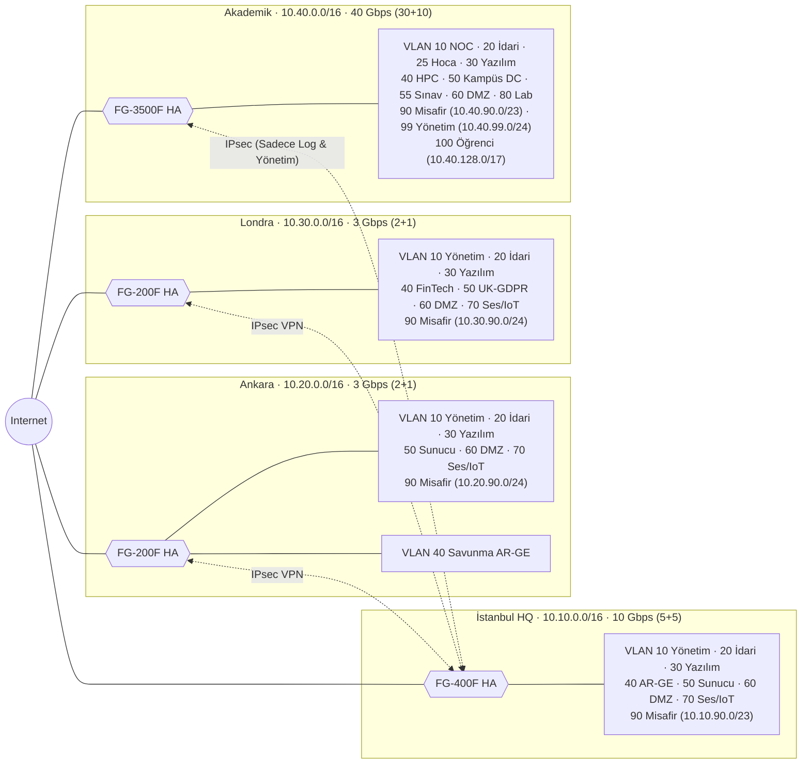
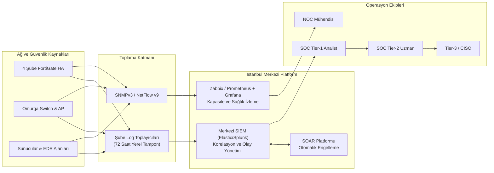

# Vize Projesi – Kurumsal Ağ Tasarımı: Bant Genişliği ve Güvenlik Duvarları

> Bu depo, **Kalkan Bilişim ve Eğitim Teknolojileri A.Ş.** için bant genişliği hesabını, alt ağ ve VLAN bölünmesini, şube bazlı yeni nesil güvenlik duvarı (NGFW) seçimlerini, kural setlerini, yüksek erişilebilirlik (HA) mimarisini, yedekleme rutinini ve izleme (monitoring) altyapısını içerir. Tüm kurumsal ağ ve güvenlik politikaları insan tarafından okunabilir kapsamlı teknik dokümantasyon (`README.md`) ve BGT207 os-lab standartlarına tam uyumlu makinece doğrulanabilir manifestosu (`company.json`) olarak iki dosyada yapılandırılmıştır.

---

## 1. Senaryo: Kalkan Bilişim ve Eğitim Teknolojileri A.Ş.

Kurgusal şirketimiz **Kalkan Bilişim ve Eğitim Teknolojileri A.Ş.**; İstanbul Genel Merkezi (Veri Merkezi barındıran Hub), Ankara Ofisi (Savunma & Kamu Ar-Ge), Londra Ofisi (UK-GDPR ve EMEA FinTech operasyonu) ve geniş kapsamlı bir Akademik Kampüsten (10.000 öğrenci ve 750 personel) oluşmaktadır.

Kurum bünyesinde yer alan toplam **11.600 kullanıcının 10.000'i öğrencidir**. Tasarımın ana hedefi:
1. Her kullanıcı profiline (idari, yazılım, Ar-Ge, akademisyen, öğrenci, misafir) iş ve eğitim gereksinimlerine göre yeterli bant genişliğini matematiksel olarak hesaplayıp garanti etmek.
2. Sıfır Güven (Zero Trust) ve En Az Yetki (Least Privilege) ilkeleri doğrultusunda şubeler arası ve bölgeler arası trafiği denetlemek.
3. Ağın dış kenarında port taraması ve siber keşif faaliyetlerini **Drop (Sessizce Düşür)** politikası ile bertaraf etmek, kural zincirlerinin sonunu **Açık Varsayılan Engelleme (Explicit Default-Deny)** ile kilitlemek.

---

### Şube Bazlı Kullanıcı Sayıları, Bant Genişliği ve Güvenlik Duvarı Matrisi

Aşağıdaki matris, şube bazında rol dağılımını, formül gereksinimi olan pik bant genişliğini, tahsis edilen metro internet hatlarını ve seçilen Active-Passive High Availability (HA) NGFW modellerini özetlemektedir:

| Branch | Admin staff | Faculty | Students | Software | Technical | Security | R&D | Total | Required (formula) | Primary + backup link | Selected NGFW (HA) |
| :--- | :---: | :---: | :---: | :---: | :---: | :---: | :---: | :---: | :---: | :---: | :--- |
| [Istanbul Office](#istanbul-genel-merkez--veri-merkezi-10100016) | 280 | 0 | 0 | 60 | 35 | 25 | 20 | **420** | 3.95 Gbps | 5 + 5 Gbps | **FortiGate 400F** |
| [Ankara Office](#ankara-ofisi-kamu-projeleri--savunma-ar-ge-10200016) | 140 | 0 | 0 | 30 | 20 | 15 | 15 | **220** | 1.50 Gbps | 2 + 1 Gbps | **FortiGate 200F** |
| [London Office](#london-office-uk--emea-hub-10300016) | 135 | 0 | 0 | 30 | 18 | 15 | 12 | **210** | 1.35 Gbps | 2 + 1 Gbps | **FortiGate 200F** |
| [Academic Branch](#akademik-şube-10400016-ve-101000016) | 220 | 400 | 10,000 | 30 | 60 | 0 | 40 | **10,750** | 27.29 Gbps | 30 + 10 Gbps | **FortiGate 3500F** |
| **Total** | **775** | **400** | **10,000** | **150** | **133** | **55** | **87** | **11,600** | **34.09 Gbps** | **39 + 17 Gbps** | |

**Temel Ağ Varsayımları:**
- Her şubenin en az iki bağımsız internet servis sağlayıcısından (ISP) yedekli (Active-Passive / BGP multihomed) metro Ethernet bağlantısı bulunmaktadır.
- Şubeler İstanbul veri merkezine yedekli IPsec VPN tünelleriyle bağlıdır.
- Merkezi kurumsal servisler (Active Directory, ERP, GitLab, SIEM) İstanbul veri merkezindedir.
- Akademik kampüsün 10.000 öğrencilik Eduroam Wi-Fi trafiği şubeler arası kurumsal IPsec tünellerine verilmez; yerel donanımsal CGNAT ile doğrudan filtrelenmiş internete çıkarılır.

---

## 2. Ağ Topolojisi ve VLAN / IP Planı

Ağ mimarisi **Hub-and-Spoke (Yıldız)** topolojisindedir. İstanbul Genel Merkezi veri merkezi omurgasıdır; Ankara ve Londra ofisleri şifreli IPsec tünelleri ile merkeze bağlıdır. Akademik Şube ise yalnızca yasal log aktarımı, merkezi SIEM ve NOC yönetimi için merkeze tünel açar.

Tüm şubelerdeki misafir (guest) ağları, şubelerin kendi `/16` CIDR blokları içerisine alınarak IP hiyerarşisi ve yönlendirme bütünlüğü sağlanmıştır.



---

### İstanbul (Genel Merkez & Veri Merkezi) – `10.10.0.0/16`

*Toplam 420 Kullanıcı (280 İdari, 60 Yazılım, 35 Teknik, 25 Güvenlik/SOC, 20 Ar-Ge)*

| VLAN | Alt Ağ | Kullanım Amacı | Güvenlik Seviyesi |
| ---: | :--- | :--- | :--- |
| **10** | `10.10.10.0/24` | Bant-Dışı Yönetim (Firewall HA, Omurga Switch, SOC) | Çok Yüksek (Yalnızca MFA'lı Bastion) |
| **20** | `10.10.20.0/23` | Kurumsal İdari Personel (280 kullanıcı) | Standart Kurumsal |
| **30** | `10.10.30.0/24` | Yazılım Geliştirme Ekibi (60 mühendis) | Yüksek (Git/CI-CD erişimi, DLP) |
| **40** | `10.10.40.0/24` | Ar-Ge & Yapay Zeka Laboratuvarı (20 araştırmacı) | Çok Yüksek (Doğrudan internet kapalı) |
| **50** | `10.10.50.0/24` | Kurumsal Veri Merkezi (AD DS, ERP, GitLab, SIEM) | Kritik (Mikro-segmentasyon) |
| **60** | `10.10.60.0/24` | DMZ (WAF, SSL-VPN Ağ Geçidi, Harici API) | Yalıtılmış Dış Düzlem |
| **70** | `10.10.70.0/23` | VoIP Santrali ve Güvenlik Kameraları / IoT | Yalıtılmış IoT |
| **90** | `10.10.90.0/23` | Misafir ve Stajyer Wi-Fi (Şube bloğu içinde izole) | Düşük (Sadece Filtrelenmiş İnternet) |

---

### Ankara Ofisi (Kamu Projeleri & Savunma Ar-Ge) – `10.20.0.0/16`

*Toplam 220 Kullanıcı (140 İdari, 30 Yazılım, 20 Teknik, 15 Güvenlik, 15 Savunma Ar-Ge)*

| VLAN | Alt Ağ | Kullanım Amacı | Güvenlik Seviyesi |
| ---: | :--- | :--- | :--- |
| **10** | `10.20.10.0/24` | Yerel Yönetim ve Sistem Ağı (35 IT/Güvenlik) | Çok Yüksek (MFA zorunlu) |
| **20** | `10.20.20.0/24` | Kamu Projeleri ve İdari Personel (140 kullanıcı) | Standart Kurumsal |
| **30** | `10.20.30.0/24` | Savunma Yazılım Ekibi (30 mühendis) | Yüksek (Statik kod analizi, DLP) |
| **40** | `10.20.40.0/24` | Savunma Sanayii Ar-Ge (15 araştırmacı) | En Yüksek (İnternetsiz, Air-Gap tarzı) |
| **50** | `10.20.50.0/24` | Yerel Sunucular (Salt-Okunur RODC, Paket Aynası) | Yüksek |
| **60** | `10.20.60.0/24` | Kamu B2B Güvenli VPN Geçidi (DMZ) | Sıkı Denetimli (IPsec + mTLS) |
| **70** | `10.20.70.0/24` | VoIP ve Biyometrik Geçiş Sistemleri | Yalıtılmış IoT |
| **90** | `10.20.90.0/24` | Misafir Wi-Fi (Şube bloğu içinde izole) | Düşük (Sadece Filtrelenmiş İnternet) |

---

### London Office (UK & EMEA Hub) – `10.30.0.0/16`

*Toplam 210 Kullanıcı (135 İdari/Hukuk, 30 Bulut/SRE, 18 Teknik, 15 Güvenlik, 12 FinTech Ar-Ge)*

| VLAN | Alt Ağ | Kullanım Amacı | Güvenlik Seviyesi |
| ---: | :--- | :--- | :--- |
| **10** | `10.30.10.0/24` | Londra IT ve Güvenlik Yönetim Düzlemi (33 personel) | Çok Yüksek |
| **20** | `10.30.20.0/24` | İdari, Hukuk ve EMEA Satış (135 kullanıcı) | Standart Kurumsal |
| **30** | `10.30.30.0/24` | Bulut Altyapı ve SRE Ekibi (30 mühendis) | Yüksek (AWS Direct Connect / VPN) |
| **40** | `10.30.40.0/24` | FinTech & Blokzincir Ar-Ge (12 araştırmacı) | Çok Yüksek (Sandbox kontrollü çıkış) |
| **50** | `10.30.50.0/24` | UK-GDPR Veri Saklama Sunucuları | Çok Yüksek (Sınır ötesi veri yasağı) |
| **60** | `10.30.60.0/24` | DMZ (GlobalProtect / SSL-VPN, API Ağ Geçidi) | Yalıtılmış Dış Düzlem |
| **70** | `10.30.70.0/24` | VoIP ve Akıllı Ofis IoT Cihazları | Yalıtılmış IoT |
| **90** | `10.30.90.0/24` | Misafir Wi-Fi (Şube bloğu içinde izole) | Düşük (Sadece Filtrelenmiş İnternet) |

---

### Akademik Şube – `10.40.0.0/16`

*Toplam 10.750 Kullanıcı (10.000 Öğrenci, 400 Hoca, 220 İdari, 60 Teknik/NOC, 40 HPC Ar-Ge, 30 Yazılım)*

| VLAN | Alt Ağ | Kullanım Amacı | Güvenlik Seviyesi |
| ---: | :--- | :--- | :--- |
| **10** | `10.40.10.0/24` | Kampüs NOC Operasyon Düzlemi (60 teknik personel) | Yüksek (Rol bazlı erişim) |
| **20** | `10.40.20.0/23` | Kampüs İdari Personel (220 kullanıcı - Öğrenci İşleri) | Standart Kurumsal |
| **25** | `10.40.24.0/22` | Akademisyenler & Fakülte (400 hoca) | Yüksek (Öğrenci ağından izole) |
| **30** | `10.40.30.0/24` | Kampüs Yazılım Ekibi (30 mühendis - OBS/LMS) | Yüksek |
| **40** | `10.40.40.0/24` | Yüksek Başarımlı Hesaplama (HPC) & Ar-Ge (40 araştırmacı) | Yüksek (ULAKBİM / GridFTP) |
| **50** | `10.40.50.0/24` | Kampüs Veri Merkezi (OBS Veritabanı, FreeRADIUS, 5651) | Kritik (Sadece WAF/İdari izinli) |
| **55** | `10.40.52.0/22` | Dijital Sınav Salonları | Kritik (İnternete ve dış dünyaya tam kapalı) |
| **60** | `10.40.60.0/24` | DMZ (LMS Moodle, OBS Web Portalı, FortiWeb WAF) | Yalıtılmış Dış Düzlem |
| **80** | `10.40.80.0/21` | Öğrenci Bilgisayar Laboratuvarları | Orta (İç sunuculara kapalı) |
| **90** | `10.40.90.0/23` | Konferans & Misafir Wi-Fi (Şube bloğu içinde izole) | Düşük (Sadece Filtrelenmiş İnternet) |
| **99** | `10.40.99.0/24` | **Kampüs Bant-Dışı Yönetim (OOB Management)** | **Çok Yüksek (Sadece VPN/NOC Bastion)** |
| **100** | `10.40.128.0/17` | Eduroam Öğrenci Wi-Fi Havuzu (10.000 öğrenci / 32.766 IP) | İzole (CGNAT + Kategori Web Filtre) |

> **Öğrenci Ağı İçin `/16` Seçim Nedeni:** 10.000 aktif öğrenci kişi başı ortalama 1.8 mobil/akıllı cihaz (telefon, tablet, laptop) taşımaktadır. Yoğun saatlerde eşzamanlı aktif cihaz adedi 12.000'i aşmaktadır. `/16` adresi (65.534 kullanılabilir adres), DHCP lease sürelerinin kısalığı ve genişleme payı göz önüne alındığında IP tükenmesini (exhaustion) kesin olarak önler.

---

## 3. Bant Genişliği Hesabı ve Dağıtımı

Bant genişliği gereksinimleri, her bir kullanıcı grubunun eşzamanlılık oranı, cihaz çarpanı, cihaz başı ortalama trafik tüketimi, kapsülleme (IPsec/TLS ek yükü) ve pik büyüme marjı dikkate alınarak uluslararası standart formülle hesaplanmıştır:

$$B_{toplam} = \left( \sum_i N_i \times C_i \times M_i \times b_i \right) \times (1 + O_{encap}) \times (1 + H_{burst})$$

**Değişkenler ve Parametreler:**
- $N_i$: Rol grubundaki toplam kullanıcı sayısı.
- $C_i$: Eşzamanlılık (concurrency) oranı (kurumsal %65–%85, kampüs %65–%75).
- $M_i$: Kullanıcı başına ortalama aktif cihaz sayısı ($1.2 - 1.8$).
- $b_i$: Cihaz başına ortalama bant genişliği ihtiyacı ($1.7 - 8.0\text{ Mbps}$).
- $O_{encap}$: Kapsülleme ve tünelleme ek yükü (%12 kurumsal ofisler; %10 akademik şube).
- $H_{burst}$: Beklenmeyen pik ve yıllık büyüme payı (%30 kurumsal ofisler; %25 akademik şube).

### Kullanıcı Rolü Parametre Tablosu

| Rol | Eşzamanlılık ($C$) | Cihaz ($M$) | Cihaz Hızı ($b$) | Kişi Başı Pik | Baskın Ağ Trafiği |
| :--- | :---: | :---: | :---: | :---: | :--- |
| **İdari Personel** | %65 | 1.2 | 2.5 Mbps | 1.95 Mbps | ERP, SaaS Ofis 365, VoIP, Teams |
| **Yazılım Ekibi** | %85 | 1.5 | 6.0 Mbps | 7.65 Mbps | Git, Docker registry, CI/CD, Artifact |
| **Ar-Ge Ekibi** | %85 | 1.6 | 8.0 Mbps | 10.88 Mbps | Büyük veri setleri, yapay zeka modelleri |
| **Teknik / IT / SOC** | %80 | 1.5 | 5.0 Mbps | 6.00 Mbps | Yama dağıtımı, SSH/RDP, uzaktan konsol |
| **Hoca / Fakülte** | %75 | 1.5 | 3.5 Mbps | 3.94 Mbps | Canlı amfi dersleri, akademik veritabanı |
| **Öğrenci** | %65 | 1.8 | 1.7 Mbps | 1.99 Mbps | LMS (Moodle), video ders, araştırma, web |

---

### Şube Bazında Formül Sonuçları ve Hat Tahsisleri

| Şube / Lokasyon | Hesaplama Detayı | Gerekli (Formül) | Tahsis Edilen Hat (Ana + Yedek) | Seçilen Güvenlik Duvarı (HA) |
| :--- | :--- | :---: | :--- | :--- |
| **İstanbul Ofisi** | İdari (280) + Yazılım (60) + Teknik/Güvenlik (60) + Ar-Ge (20) + DMZ/DC | **3.95 Gbps** | **5 + 5 Gbps = 10 Gbps** | **FortiGate 400F HA** |
| **Ankara Ofisi** | İdari (140) + Yazılım (30) + Teknik/Güvenlik (35) + Ar-Ge (15) + Kamu B2B | **1.50 Gbps** | **2 + 1 Gbps = 3 Gbps** | **FortiGate 200F HA** |
| **Londra Ofisi** | İdari (135) + Yazılım (30) + Teknik/Güvenlik (33) + Ar-Ge (12) + Bulut/API | **1.35 Gbps** | **2 + 1 Gbps = 3 Gbps** | **FortiGate 200F HA** |
| **Akademik Şube** | Öğrenci (10.000) + Hoca (400) + İdari (220) + Teknik (60) + Ar-Ge (40) + Yazılım (30) | **27.29 Gbps** | **30 + 10 Gbps = 40 Gbps** | **FortiGate 3500F HA** |
| **GENEL TOPLAM** | **11.600 Kullanıcı Genel Pik İhtiyacı** | **34.09 Gbps** | **39 + 17 Gbps = 56 Gbps** | |

> **Hat Yedekliliği ve Dayanıklılık Garantisi:** Her şubede çift ISP hattı bulunmaktadır. Ana hatlardan birinin tamamen fiziksel olarak kopması durumunda dahi, yedek hat formülle hesaplanan pik bant genişliğini karşılayacak kapasitededir (örneğin İstanbul'da yedek 5 Gbps $\ge$ 3.95 Gbps; Ankara'da 2+1 Gbps hattında ana hat 2 Gbps $\ge$ 1.50 Gbps; Akademik Şubede 30 Gbps ana hat $\ge$ 27.29 Gbps).

---

### Trafik Şekillendirme (QoS) ve Önceliklendirme

Fiziksel hattın taşmasını önlemek amacıyla NGFW üzerinde DSCP etiketleme ve trafik sınıfları tanımlanmıştır:

| Sınıf | Öncelik & Açıklama | DSCP | Garanti | Tavan (Burst) |
| :---: | :--- | :---: | :---: | :---: |
| **Sınıf 1** | Gerçek Zamanlı Trafik (VoIP SIP/RTP, Canlı Amfi Dersi) | `EF (46)` | %10 | %20 |
| **Sınıf 2** | Ağ Kontrol ve Yönetim (BGP, IPsec IKEv2, OSPF, SIEM TLS) | `CS6 (48)` | %5 | %15 |
| **Sınıf 3** | Kritik İş ve Sınav Sistemleri (ERP, OBS, LMS Moodle, Sınav Salonu) | `AF41 (34)` | %25 | %60 |
| **Sınıf 4** | Yazılım ve Ar-Ge (GitLab, CI/CD Runner, HPC Veri Transferi) | `AF31 (26)` | %25 | %70 |
| **Sınıf 5** | Kurumsal Standart Trafik (Ofis 365, Web, E-posta) | `AF21 (18)` | %15 | %50 |
| **Sınıf 6** | Öğrenci Genel İnternet (Eduroam Wi-Fi, Genel Web Gezintisi) | `BE (0)` | %15 | %55 |
| **Sınıf 7** | Toplu Veri ve Güncelleme (OS güncellemeleri, Veritabanı replikasyonu) | `AF11 (10)` | %5 | %25 |
| **Sınıf 8** | Misafir Ağı (Ziyaretçi Wi-Fi) | `CS1 (8)` | %0 | %10 |

**Kullanıcı Başı Oturum ve Hız Sınırları:**
- **Öğrenci (VLAN 100):** Cihaz başına 15 Mbps indirme / 8 Mbps yükleme sınırı; en fazla 400 eşzamanlı TCP/UDP oturumu; P2P/Torrent ve kripto madencilik trafiği uygulama denetimiyle tamamen bloklanır.
- **Misafir (VLAN 90):** Kullanıcı başına 5 Mbps hız sınırı; yalnızca HTTP, HTTPS ve güvenli DNS çıkışı; iç şebekeye ve diğer misafirlere tam erişim yasağı.
- **Öğrenci CGNAT:** Port Block Allocation (PBA) ile her öğrenciye 512 portluk blok tahsis edilir ve port eşleşmeleri 5651 sayılı kanun uyarınca zaman damgalı loglanır.

---

## 4. Adım Adım Güvenlik Duvarı Kurulumu ve Sertleştirme

Tüm şubelerdeki yeni nesil güvenlik duvarı (NGFW) kurulumları 15 aşamalı standart mühendislik prosedürüne göre yürütülür:

1. **Varlık Envanteri ve Tehdit Modellemesi:** Şubedeki tüm kullanıcı sayıları, IP blokları, kritik sunucular ve veri akışları belirlenir.
2. **Sıfır Güven (Zero Trust) Politikası Belirlenmesi:** En az yetki ilkesi ve "varsayılan engelleme" taban politikası tanımlanır.
3. **Fiziksel Kurulum ve Çift Güç (Dual PSU):** Cihaz kabinet içerisine monte edilir; yedekli PDU'lara bağlanır; LACP omurga switch trunk kablolaması yapılır.
4. **Cihaz Sertleştirme (Device Hardening):**
   - Fabrika varsayılan parolaları değiştirilir.
   - HTTP, Telnet gibi güvensiz yönetim protokolleri global olarak kapatılır; yalnızca SSH (v2) ve HTTPS açılır.
   - Yönetim düzlemi (Management GUI/CLI) yalnızca Yönetim VLAN'ına (`VLAN 10` veya `VLAN 99`) sınırlandırılır; internete veya kullanıcı ağlarına asla açılmaz.
   - Yöneticiler için RADIUS / SAML entegrasyonlu Çok Faktörlü Kimlik Doğrulama (MFA) zorunlu tutulur.
   - NTP sunucuları ayarlanır ve zaman senkronizasyonu kilitlenir.
5. **Yüksek Erişilebilirlik (HA) Konfigürasyonu:** Cihazlar yedekli özel kalp atışı (heartbeat) kablolarıyla Active-Passive modda kümelenir; bağlantı izleme (interface monitoring) açılır (otomatik devralma süresi < 1 saniye).
6. **Güvenlik Bölgeleri (Zones) ve Alt Arayüzler:** 802.1Q trunk arayüzler üzerinde her VLAN için alt arayüz (sub-interface) oluşturulur ve güvenlik bölgelerine atanır (`LAN`, `WAN`, `DMZ`, `MGMT`, `GUEST`).
7. **Adresleme ve NAT Kurulumu:** İç kullanıcılar için çıkışta Source NAT (veya akademikte CGNAT); DMZ'deki WAF/LMS için Destination NAT (VIP) tanımlanır.
8. **Güvenlik Politikası ve Kural Sıralaması:** En özel kurallar en üstte, genel kurallar ortada ve en sonda açık varsayılan engelleme yer alır.
9. **Şubeler Arası IPsec Tünelleri:** IKEv2, AES-256-GCM, SHA-384, DH Grup 20 kriptografik parametreleriyle tüneller kurulur; BGP üzerinden dinamik rota paylaşımı yapılır.
10. **Rol Bazlı Uzaktan Erişim VPN (GlobalProtect / FortiClient):** Uzaktan çalışan teknik ve idari personel için posture check (cihaz sağlık denetimi) ve MFA şartı konur; öğrencilere VPN hesabı açılmaz.
11. **Derin Paket Denetimi ve Güvenlik Profilleri:** IPS, Antivirüs, Web Filtre, DNS Filtre ve Uygulama Kontrolü aktif edilir. Finans/sağlık siteleri SSL incelemeden muaf tutulur; öğrenci ağında KVKK gereği şifre çözme yerine kategori bazlı filtreleme uygulanır.
12. **Bant Genişliği ve QoS Kuralları:** Bölüm 3'teki öncelik ve hız sınırları cihazın trafik şekillendiricisine (Traffic Shaper) işlenir.
13. **Merkezi Loglama ve Yasal Uyum:** Syslog TLS (RFC 5424) üzerinden tüm loglar İstanbul SIEM'e akar; 5651 sayılı kanun gereği IP-Port-Kullanıcı logları saatlik özetlenip TÜBİTAK zaman damgasıyla imzalanır.
14. **Doğrulama, Sızma Testi ve Devreye Alma:** Nmap port taramaları, VLAN atlama (VLAN hopping) testleri, HA devretme (failover) ve hat kesinti testleri yapılarak sistem üretime alınır.
15. **Yedekleme Rutini ve Değişiklik Yönetimi:** Otomatik günlük konfigürasyon yedeği ve sürüm kontrolü (Git) devreye alınır (Bölüm 10).

---

## 5. Güvenlik Mimarisi İlkeleri: Dış Kenarda Drop ve En Sonda Açık Default-Deny

Sistem güvenliğinde iki kritik mühendislik ilkesi titizlikle uygulanmıştır:

### A. Dış Kenarda "Reject" Yerine "Drop" (Sessizce Düşür) İlkesi
- **Reject (Reddet):** Bir paket engellendiğinde, güvenlik duvarı istemciye bir TCP RST (bağlantı sıfırlandı) veya ICMP Port Unreachable paketi geri gönderir. Bu durum iç ağdaki güvenilir istemcilerin bağlantıyı anında kapatması için kullanışlı olsa da, **dış internet sınırında (Perimeter)** büyük bir güvenlik zaafiyetidir.
- **Drop (Düşür - `action: "deny"`):** Güvenlik duvarı gelen yetkisiz paketi hiçbir cevap üretmeksizin doğrudan çöpe atar.
- **Neden Tercih Edildi?**
  1. **Keşif ve Port Taramalarını Engelleme:** Saldırganların Nmap veya Masscan gibi araçlarla yaptığı SYN taramalarında hedef IP'nin veya portun açık/kapalı olduğu anlaşılamaz; tarama araçları zaman aşımına (timeout) uğrar ve tarama süreleri yüzlerce kat uzar.
  2. **Bilgi İfşasını Önleme:** Güvenlik duvarının aktif varlığı, işletim sistemi parmak izi veya yanıt süreleri dışarıya sızdırılmaz (Stealth Mode).
  3. **DDoS Yükseltme Savunması:** Sahte kaynak IP'li (IP spoofing) saldırılarda saldırganın kurbanına giden istenmeyen ICMP yanıt trafiği engellenir.

### B. Kural Seti Sonunda Açık Varsayılan Engelleme (Explicit Default-Deny)
- Çoğu güvenlik duvarı kural eşleşmediğinde varsayılan olarak paketleri düşürür (Implicit Deny). Ancak bu örtük davranış izleme ve denetim açısından yetersizdir.
- Manifestomuzda ve kural setlerimizde her şubenin en sonuna açıkça `action: "deny", from: "any", to: "any"` kuralı yerleştirilmiştir.
- Bu sayede listedeki kurallara uymayan her yetkisiz erişim girişimi güvenlik duvarı tarafından **sessizce düşürülürken**, aynı anda SIEM sistemine zaman damgalı olay kaydı (event log) düşürülerek şüpheli yanal hareketler ve saldırı denemeleri gerçek zamanlı alarmlara dönüştürülür.

---

## 6. Şube Bazlı Güvenlik Duvarı Kuralları

Kurallar yukarıdan aşağıya (First-Match) mantığıyla işlenir. Dış kenardaki yetkisiz ve şüpheli trafik **Düşür (Drop)** edilirken, tablonun son satırı **Açık Varsayılan Engelleme (Explicit Default-Deny)** ile kapanmaktadır.

### İstanbul (FortiGate 400F)

| # | Kaynak | Hedef | Protokol / Port | İşlem | Güvenlik Amacı ve Not |
| ---: | :--- | :--- | :--- | :---: | :--- |
| **1** | Dış Ağ (Internet) | DMZ (WAF / Reverse Proxy) | TCP 443 | **İzin (Allow)** | Dış dünyaya açık tek HTTPS web kapısı (WAF ve IPS korumalı) |
| **2** | Yönetim VLAN 10 | Tüm Cihazlar | SSH, HTTPS, SNMPv3 | **İzin (Allow)** | Yalnızca yetkili SOC/NOC istasyonlarından MFA ile yönetim |
| **3** | Şube IPsec VPN | İstanbul SIEM (10.10.50.25) | Syslog TLS 6514 | **İzin (Allow)** | Şubelerden şifreli merkezi log toplama |
| **4** | İdari VLAN 20 | Sunucu VLAN 50 | ERP, AD DS, Kerberos | **İzin (Allow)** | Personelin kurumsal merkezi sunuculara iş erişimi |
| **5** | İdari VLAN 20 | Yazılım / Ar-Ge / Yönetim | Tümü | **Düşür (Drop)** | İdari ağdan teknik ve yönetim düzlemine yanal hareket engeli |
| **6** | Yazılım VLAN 30 | Sunucu VLAN 50 (GitLab/Harbor) | SSH, HTTPS | **İzin (Allow)** | Kaynak kod ve imaj depolarına güvenli geliştirici erişimi |
| **7** | Ar-Ge VLAN 40 | Kurumsal Proxy (8443) | TCP 8443 | **İzin (Allow)** | Yapay zeka ve Ar-Ge araştırması için sıkı DLP kontrollü vekil çıkış |
| **8** | Ar-Ge VLAN 40 | İnternet (Doğrudan) | Tümü | **Düşür (Drop)** | Ar-Ge ağından doğrudan internete çıkış ve veri sızdırma kesin engeli |
| **9** | Misafir VLAN 90 | Kurumsal İç Ağlar (VLAN 10-70) | Tümü | **Düşür (Drop)** | Misafirlerin kurumsal sunuculara veya personele erişimi kapalıdır |
| **10** | Dış Ağ (Internet) | Yönetim VLAN 10 | Tümü | **Düşür (Drop)** | Yönetim düzlemi internete tamamen kapalıdır (yalnızca dahili VPN) |
| **11** | Dış Ağ (Internet) | Herhangi Bir Yer | TCP 22 (SSH) | **Düşür (Drop)** | Dış kenarda SSH taramalarını sessizce düşür (IP/Port keşfini önle) |
| **12** | **Herhangi Bir Yer** | **Herhangi Bir Yer** | **Tümü** | **Düşür (Drop)** | **Açık Varsayılan Engelleme (Explicit Default-Deny): Listede eşleşmeyen tüm gelen ve transit paketleri sessizce düşür ve logla** |

---

### Ankara Ofisi (FortiGate 200F)

| # | Kaynak | Hedef | Protokol / Port | İşlem | Güvenlik Amacı ve Not |
| ---: | :--- | :--- | :--- | :---: | :--- |
| **1** | Kamu Kurumları (Beyaz Liste) | DMZ-B2B | IPsec, mTLS 8443 | **İzin (Allow)** | Kamu projeleri karşılıklı mTLS sertifikalı B2B veri geçidi |
| **2** | Yönetim VLAN 10 | Yerel Sunucular & Ağ Cihazları | SSH, HTTPS, SNMPv3 | **İzin (Allow)** | Yerel IT yönetimi (MFA zorunlu) |
| **3** | Yazılım VLAN 30 | İstanbul GitLab (IPsec) | Git SSH, HTTPS | **İzin (Allow)** | Ankara yazılım ekibinin merkez kod deposu erişimi |
| **4** | Savunma Ar-Ge VLAN 40 | Yerel RODC & NTP | Kerberos, DNS, NTP | **İzin (Allow)** | Savunma laboratuvarı yerel kimlik doğrulama |
| **5** | Savunma Ar-Ge VLAN 40 | İmzalı Yerel Paket Aynası | HTTPS 443 | **İzin (Allow)** | Güvenlik testleri için yerel ve denetimli kütüphane erişimi |
| **6** | Savunma Ar-Ge VLAN 40 | İnternet | Tümü | **Düşür (Drop)** | Savunma Ar-Ge ağının dış internete hiçbir doğrudan çıkışı yoktur |
| **7** | Diğer Tüm VLAN'lar | Savunma Ar-Ge VLAN 40 | Tümü | **Düşür (Drop)** | Savunma Ar-Ge laboratuvarına dışarıdan yetkisiz erişim kapalıdır |
| **8** | Dış Ağ (Internet) | Yönetim VLAN 10 | Tümü | **Düşür (Drop)** | Yönetim ağına doğrudan erişim kapalıdır |
| **9** | Dış Ağ (Internet) | Herhangi Bir Yer | TCP 22 (SSH) | **Düşür (Drop)** | Dış kenarda SSH taramalarını sessizce düşür (IP/Port keşfini önle) |
| **10** | **Herhangi Bir Yer** | **Herhangi Bir Yer** | **Tümü** | **Düşür (Drop)** | **Açık Varsayılan Engelleme (Explicit Default-Deny): Listede eşleşmeyen tüm gelen trafiği sessizce düşür ve logla** |

---

### London Office (FortiGate 200F)

| # | Kaynak | Hedef | Protokol / Port | İşlem | Güvenlik Amacı ve Not |
| ---: | :--- | :--- | :--- | :---: | :--- |
| **1** | Dış Ağ (Internet) | DMZ (WAF / API Gateway) | TCP 443 | **İzin (Allow)** | EMEA müşterileri için HTTPS web ve harici API geçidi |
| **2** | Yönetim VLAN 10 | Ağ Cihazları & Sunucular | SSH, HTTPS | **İzin (Allow)** | Londra teknik ekip yerel yönetimi |
| **3** | Maskeli Log Toplayıcı | İstanbul SIEM (IPsec) | Syslog TLS 6514 | **İzin (Allow)** | UK-GDPR uyumlu kimliksizleştirilmiş log aktarımı |
| **4** | Yazılım VLAN 30 | AWS London VPC | SSH, HTTPS, K8s API | **İzin (Allow)** | Bulut DevOps ve SRE operasyonu (DLP denetimli) |
| **5** | UK-GDPR Veri Sunucusu VLAN 50 | İstanbul / İnternet | SQL, SMB, rsync | **Düşür (Drop)** | **UK-GDPR Veri Yerelliği:** Ham kişisel veri içeren DB'ler ülke dışına çıkarılamaz |
| **6** | FinTech Ar-Ge VLAN 40 | Onaylı Sandbox / API | HTTPS 443 | **İzin (Allow)** | FinTech Ar-Ge testleri için onaylı hedeflere DLP kontrollü çıkış |
| **7** | FinTech Ar-Ge VLAN 40 | Genel İnternet | Tümü | **Düşür (Drop)** | Ar-Ge ağının genel internete kontrolsüz çıkışı yasaktır |
| **8** | Dış Ağ (Internet) | Yönetim VLAN 10 | Tümü | **Düşür (Drop)** | Yönetim ağı internete tamamen kapalıdır |
| **9** | Dış Ağ (Internet) | Herhangi Bir Yer | TCP 22 (SSH) | **Düşür (Drop)** | Dış kenarda SSH taramalarını sessizce düşür (IP/Port keşfini önle) |
| **10** | **Herhangi Bir Yer** | **Herhangi Bir Yer** | **Tümü** | **Düşür (Drop)** | **Açık Varsayılan Engelleme (Explicit Default-Deny): Tanımsız tüm harici ve transit trafiği sessizce düşür ve logla** |

---

### Akademik Şube (FortiGate 3500F)

| # | Kaynak | Hedef | Protokol / Port | İşlem | Güvenlik Amacı ve Not |
| ---: | :--- | :--- | :--- | :---: | :--- |
| **1** | Dış Ağ (Internet) | DMZ (LMS Moodle, OBS Web) | TCP 443 | **İzin (Allow)** | Öğrenci ve hocalar için kampüs dışı uzaktan eğitim girişi (WAF arkasında) |
| **2** | Kampüs NOC VLAN 10 | Ağ Cihazları & Kampüs DC | SSH, HTTPS, SNMPv3 | **İzin (Allow)** | Kampüs mühendisleri teknik operasyon erişimi |
| **3** | Kampüs DC (RADIUS) | Eduroam AP Kontrolcüsü | UDP 1812, 1813 | **İzin (Allow)** | 10.000 öğrenci Eduroam 802.1X WPA3-Enterprise kimlik doğrulama |
| **4** | İdari VLAN 20 | Kampüs DC (OBS/DB) | HTTPS, LDAPS | **İzin (Allow)** | Öğrenci İşleri ve idari kayıt yönetimi |
| **5** | Hoca VLAN 25 | Kampüs DC & DMZ (LMS) | HTTPS, SSH | **İzin (Allow)** | Akademisyenlerin not girişi, ders yükleme ve araştırma erişimi |
| **6** | Sınav Salonları VLAN 55 | Yerel Sınav Sunucusu | HTTPS 443 | **İzin (Allow)** | Dijital sınav istemcilerinin yerel sınav oturumuna erişimi |
| **7** | Sınav Salonları VLAN 55 | İnternet & Dış Ağlar | Tümü | **Düşür (Drop)** | **Sınav Güvenliği:** Sınav salonları dış internete tamamen kapalıdır |
| **8** | Öğrenci Wi-Fi VLAN 100 | DMZ (LMS / OBS Portalı) | TCP 443 | **İzin (Allow)** | Kampüs içi güvenli ders ve not görüntüleme |
| **9** | Öğrenci Wi-Fi VLAN 100 | İdari / Hoca / Kampüs DC | Tümü | **Düşür (Drop)** | **Segmentasyon:** Öğrencilerin idari sunucu ve hoca bilgisayarlarına erişimi yasaktır |
| **10** | Öğrenci Wi-Fi VLAN 100 | İnternet | P2P, Tor, Kripto | **Düşür (Drop)** | Torrent, proxy ve kripto madencilik trafiği uygulama katmanında engellenir |
| **11** | Öğrenci Wi-Fi VLAN 100 | İnternet | HTTP, HTTPS, DNS | **İzin (Allow)** | CGNAT ve içerik filtresi üzerinden genel internet çıkışı (15/8 Mbps kota) |
| **12** | Misafir VLAN 90 | İnternet | HTTP, HTTPS, DNS | **İzin (Allow)** | Misafir Wi-Fi internet çıkışı (5 Mbps limit, iç ağlara kapalı) |
| **13** | Yönetim VLAN 99 / NOC | Güvenlik Duvarı HA & Omurga | SSH, HTTPS | **İzin (Allow)** | Bant-dışı yönetim düzlemi güvenli erişimi (MFA zorunlu) |
| **14** | Herhangi Bir Yer | Yönetim VLAN 99 | Tümü | **Düşür (Drop)** | Yönetim düzlemine yetkisiz hiçbir bölgeden doğrudan erişilemez |
| **15** | Dış Ağ (Internet) | Herhangi Bir Yer | TCP 22 (SSH) | **Düşür (Drop)** | Dış sınırda kamusal SSH ve port taramalarını sessizce düşür (IP keşfini önle) |
| **16** | **Herhangi Bir Yer** | **Herhangi Bir Yer** | **Tümü** | **Düşür (Drop)** | **Açık Varsayılan Engelleme (Explicit Default-Deny): Listede açıkça izin verilmeyen tüm gelen ve transit paketleri sessizce düşür ve logla** |

---

## 7. Şubeler Arası VPN ve Güvenli İletişim

Şubeler arası güvenli iletişimde endüstri standardı IKEv2 / IPsec protokol paketi kullanılmıştır:

| Parametre | Değer / Protokol | Güvenlik ve Uyumluluk Gerekçesi |
| :--- | :--- | :--- |
| **Anahtar Değişimi** | IKEv2 (Internet Key Exchange v2) | NAT-Traversal ve MOBIKE desteği, yüksek oturum dayanıklılığı |
| **Şifreleme Algoritması** | AES-256-GCM | Kimlik doğrulamalı şifreleme (AEAD), donanımsal hızlandırma ve yüksek verim |
| **Bütünlük Doğrulama** | SHA-384 / SHA-512 | Çarpışma (collision) dirençli kriptografik özetleme |
| **Diffie-Hellman Grubu** | Grup 20 (NIST ECP 384) | Eliptik Eğri Kriptografisi (ECC), Perfect Forward Secrecy (PFS) |
| **Dinamik Yönlendirme** | eBGP (AS65010 - AS65040) | Şube hat kesintilerinde otomatik ve sıfır kesintili rota güncellemesi |
| **Tünel Yedekliliği** | BGP BFD (Bidirectional Forwarding) | Hat kopması 300 ms içinde algılanarak yedek tünel devreye alınır |

---

## 8. Her Birim İçin En İyi 5 Güvenlik Duvarı ve Seçim

Güvenlik duvarı seçiminde yalnızca nominal port hızı değil; **IPS + Uygulama Kontrolü + Antivirüs + SSL Derin İnceleme açıkken** cihazın sürdürebildiği net verim (Threat Protection Throughput) ve eşzamanlı oturum sayısı temel alınmıştır.

Matriste belirlenen gereksinimlere göre her şube için en güçlü 5 aday cihaz kıyaslanmış ve seçimler yapılmıştır:

| Şube / Lokasyon | Formül Gereksinimi | Hat Kapasitesi (Ana+Yedek) | Seçilen Model (HA) | Seçim Gerekçesi |
| :--- | :---: | :---: | :--- | :--- |
| **İstanbul Ofisi** | 3.95 Gbps | 5 + 5 Gbps | **FortiGate 400F** | 9 Gbps Threat Protection, 10G SFP+ portları, 8M oturum ve düşük gecikme |
| **Ankara Ofisi** | 1.50 Gbps | 2 + 1 Gbps | **FortiGate 200F** | 3 Gbps Threat Protection, Kamu B2B tünelleri ve 3M oturum desteği |
| **Londra Ofisi** | 1.35 Gbps | 2 + 1 Gbps | **FortiGate 200F** | 3 Gbps Threat Protection, UK-GDPR uyumlu DLP ve IPsec verimi |
| **Akademik Şube** | 27.29 Gbps | 30 + 10 Gbps | **FortiGate 3500F** | 63 Gbps Threat Protection, NP7 donanım hızlandırmalı 10.000 öğrenci CGNAT |

---

### Aday Cihazların Karşılaştırma Matrisleri

#### 1. Akademik Şube (Gereksinim: 27.29 Gbps · Hat: 30 + 10 Gbps)

| # | Güvenlik Duvarı Modeli | Threat Protection | Firewall Throughput | Oturum Sayısı | Değerlendirme ve Karar |
| ---: | :--- | :---: | :---: | :---: | :--- |
| **1** | **Fortinet FortiGate 3500F (HA)** | **63 Gbps** | **163 Gbps** | **120 Milyon** | **SEÇİLDİ:** NP7 donanım ivmeli CGNAT (10.000 öğrenci) ve 40 Gbps hat için rakipsiz F/P. |
| 2 | Palo Alto Networks PA-5430 | 41 Gbps | 80 Gbps | 10 Milyon | Oturum kapasitesi kampüs piki için dar; donanım ve 3 yıllık lisans maliyeti bütçeyi aşar. |
| 3 | Check Point Quantum 16200 | 24 Gbps | 55 Gbps | 10 Milyon | 24 Gbps Threat Protection, 27.29 Gbps pik gereksiniminin altında darboğaza girer. |
| 4 | Cisco Secure Firewall 4125 | 32 Gbps | 75 Gbps | 25 Milyon | FXOS ve FMC arayüz karmaşıklığı; CGNAT port blok yönetiminde operasyonel yük yüksek. |
| 5 | Juniper Networks SRX4600 | 22 Gbps | 75 Gbps | 20 Milyon | IPS ve SSL açıldığında 22 Gbps'e düşerek gereksinimi karşılamaz. |

#### 2. İstanbul Ofisi (Gereksinim: 3.95 Gbps · Hat: 5 + 5 Gbps)

| # | Güvenlik Duvarı Modeli | Threat Protection | SSL İnceleme | Oturum Sayısı | Değerlendirme ve Karar |
| ---: | :--- | :---: | :---: | :---: | :--- |
| **1** | **Fortinet FortiGate 400F (HA)** | **9 Gbps** | **8 Gbps** | **8 Milyon** | **SEÇİLDİ:** 5+5 Gbps hattı ve veri merkezi SSL trafiğini darboğazsız denetler. |
| 2 | Palo Alto Networks PA-3430 | 12.7 Gbps | 8.5 Gbps | 3 Milyon | App-ID başarımı yüksek fakat FortiManager ekosistemiyle entegrasyon maliyeti yüksek. |
| 3 | Check Point Quantum 6700 | 7.6 Gbps | 5.8 Gbps | 4 Milyon | SSL inceleme altında 5.8 Gbps'e gerileyerek 10 Gbps hat piki için sınıra yaklaşır. |
| 4 | Cisco Secure Firewall 3120 | 9.5 Gbps | 4.2 Gbps | 3 Milyon | FMC yönetim konsolu ek sanal sunucu ve ek lisanslama maliyeti gerektirir. |
| 5 | Sophos XGS 4500 | 8.0 Gbps | 7.5 Gbps | 6 Milyon | Kurumsal BGP ve yüksek yoğunluklu şube IPsec tünellerinde yetersiz kalır. |

#### 3. Ankara Ofisi (Gereksinim: 1.50 Gbps · Hat: 2 + 1 Gbps)

| # | Güvenlik Duvarı Modeli | Threat Protection | SSL İnceleme | Oturum Sayısı | Değerlendirme ve Karar |
| ---: | :--- | :---: | :---: | :---: | :--- |
| **1** | **Fortinet FortiGate 200F (HA)** | **3 Gbps** | **4 Gbps** | **3 Milyon** | **SEÇİLDİ:** 2+1 Gbps hattı ve 1.50 Gbps pik yükü rahat taşır; Kamu B2B tünellerini destekler. |
| 2 | Palo Alto Networks PA-1420 | 4.8 Gbps | 3.2 Gbps | 1 Milyon | Kamu projesi bütçesi için lisans ve donanım maliyeti aşırı yüksek. |
| 3 | Check Point Quantum 6200 | 2.5 Gbps | 1.8 Gbps | 2 Milyon | SSL altında 1.5 Gbps sınıra yakın; ani yük artışlarında paket kaybı riski taşır. |
| 4 | Cisco Secure Firewall 1210 | 2.5 Gbps | 1.5 Gbps | 1 Milyon | Ayrı yönetim sunucusu gereksinimi şube operasyonunu zorlaştırır. |
| 5 | WatchGuard Firebox M390 | 1.8 Gbps | 1.2 Gbps | 800 Bin | Kamu tünellerinde yüksek şifreleme yükünde performans düşüşü yaşar. |

#### 4. Londra Ofisi (Gereksinim: 1.35 Gbps · Hat: 2 + 1 Gbps)

| # | Güvenlik Duvarı Modeli | Threat Protection | SSL İnceleme | Oturum Sayısı | Değerlendirme ve Karar |
| ---: | :--- | :---: | :---: | :---: | :--- |
| **1** | **Fortinet FortiGate 200F (HA)** | **3 Gbps** | **4 Gbps** | **3 Milyon** | **SEÇİLDİ:** UK-GDPR veri koruma kuralları, SSL inceleme ve 1.35 Gbps pik yük için ideal. |
| 2 | Palo Alto Networks PA-1410 | 3.5 Gbps | 2.5 Gbps | 1 Milyon | Yüksek yıllık lisanslama maliyeti. |
| 3 | Check Point Quantum 3800 | 1.5 Gbps | 1.0 Gbps | 1 Milyon | SSL inceleme açıldığında 1.0 Gbps'e düşerek 1.35 Gbps ihtiyacının altında kalır. |
| 4 | Juniper Networks SRX1500 | 2.5 Gbps | 1.5 Gbps | 1.5 Milyon | DLP ve SaaS uygulama görünürlüğü zayıf. |
| 5 | Cisco Secure Firewall 1210 | 2.5 Gbps | 1.5 Gbps | 1 Milyon | Konsol parçalanması ve karmaşık lisans modeli. |

---

## 9. İzleme (Monitoring): Sistem ve İnsan

Ağ güvenliği ve sürekliliği **NOC (Ağ Operasyon Merkezi)** ve **SOC (Güvenlik Operasyon Merkezi)** olmak üzere iki disiplinli yapıyla 7/24 izlenir:



### Kritik Alarm Eşikleri ve Müdahale Matrisi

| Olay ve Tetikleyici | Alarm Eşiği | Öncelik Seviyesi | Sorumlu Ekip | SLA / Müdahale Süresi |
| :--- | :--- | :---: | :---: | :---: |
| **IPsec VPN Tünel Kopması** | 1 dakika kesinti | Kritik | NOC | $\le 5$ dakika |
| **Firewall HA Senkronizasyon Kaybı** | 1 dakika kalp atışı kaybı | Kritik | NOC | $\le 5$ dakika |
| **Metro Ethernet Hat Doluluğu** | %80 üzeri, 15 dakika süresince | Yüksek | NOC | $\le 15$ dakika |
| **Güvenlik Duvarı Veri Düzlemi CPU** | %85 üzeri, 2 dakika süresince | Yüksek | NOC | $\le 10$ dakika |
| **Oturum Tablosu (State Table) Doluluğu** | %80 kapasite aşımı | Kritik | NOC / SOC | $\le 5$ dakika |
| **Başarısız Yönetici (Admin) Girişi** | 5 başarısız deneme / 5 dakika | Kritik | SOC Tier-1 | $\le 10$ dakika |
| **Öğrenci Ağında İç Ağ Tarama Girişimi** | 15 engelleme / 1 dakika | Orta | SOC Tier-1 | $\le 15$ dakika |
| **Ar-Ge Ağında Doğrudan İnternet Çıkışı** | 1 tek engellenen paket | Kritik | SOC Tier-2 | $\le 10$ dakika |
| **UK-GDPR Veri Sunucusu Yurt Dışı Sızıntısı** | 1 tek veri aktarım girişimi | Acil | SOC Tier-2 + DPO | $\le 5$ dakika |
| **5651 Yasal Zaman Damgası Sunucusu Hatası** | 15 dakika cevapsız kalma | Kritik | Uyum Ekibi | $\le 30$ dakika |

---

## 10. Güvenlik Duvarı Yedekleme Rutini ve Felaket Kurtarma Planı (Backup & Disaster Recovery)

Kurumsal ağ altyapısının kesintisizliği ve olası bir siber saldırı, donanım arızası veya insan hatası sonrasında en hızlı şekilde ayağa kaldırılabilmesi için kapsamlı bir **Yedekleme ve Felaket Kurtarma Rutini** işletilmektedir.

### A. Otomatik Günlük Konfigürasyon Yedekleme Rutini
1. **Zamanlanmış Güvenli Dışa Aktarım (Automated Scheduled Export):**
   - Her gece saat 02:00'de, tüm şubelerdeki FortiGate cihazlarının çalışan (running) konfigürasyonları FortiManager ve merkezi yedekleme sunucusuna **SCP / SFTP** üzerinden güvenli olarak çekilir.
   - Dosya adlandırma standardı: `{branch}-{device-role}-{YYYYMMDD-HHMMSS}.conf` (Örn: `ist-hq-fg400f-primary-20261108-020000.conf`).
2. **Olay Bazlı Otomatik Sürüm Kontrolü (GitOps Revision Control):**
   - Güvenlik duvarı üzerinde bir yönetici tarafından kural ekleme, silme veya nesne değişikliği yapılıp `commit` edildiği anda FortiOS Syslog üzerinden API tetiklenir.
   - Değişen konfigürasyon yerel GitLab sürüm kontrol sistemine otomatik bir `git commit` olarak kaydedilir. İki sürüm arasındaki fark (`diff`) anında SOC ve ağ yöneticilerine e-posta/Slack uyarısı olarak gönderilir (Yetkisiz değişiklik denetimi).

### B. Şifrelenmiş Bütünlük ve Güvenli Depolama
- **Parola ve Gizli Anahtar Koruması:** Dışa aktarılan konfigürasyon dosyalarındaki tüm VPN önceden paylaşılan anahtarları (PSK), yerel kullanıcı şifre hash'leri ve sertifika özel anahtarları FortiOS'un donanımsal anahtarı ve AES-256 ana parola (Master Password) koruması ile şifreli olarak dışarı çıkarılır.
- **Bütünlük Doğrulaması (Checksum):** Her yedek alındıktan hemen sonra `sha256sum` özeti hesaplanır ve `.sha256` dosyası olarak kaydedilir. Geri yükleme yapılmadan önce dosya bütünlüğü matematiksel olarak teyit edilir.

### C. 3-2-1 Yedekleme Stratejisi
Kalkan Bilişim genelinde güvenlik duvarı yedekleri 3-2-1 kuralına göre korunur:
- **3 Kopya:** Aktif cihaz üzerindeki çalışan konfigürasyon, yerel şube yedekleme deposu ve merkez veri kasası.
- **2 Farklı Medya Türü:** Yerel şifreli depolama alanı (NVMe SSD SAN/NAS) ve ayrık felaket kurtarma sunucusu.
- **1 Çevrimdışı / Değişmez (Immutable WORM) Uzak Kopya:** İstanbul veri merkezinden bağımsız, farklı bir coğrafi bölgedeki şifreli bulut kasasında kilitli ve fidye yazılımlarına (Ransomware) karşı silinemez (Object Lock / WORM) olarak saklanan kopya.

### D. Durum ve Yasal Veritabanı Yedekleri (Stateful & Legal Backups)
- **5651 Yasal Logları:** DHCP logları, NAT oturum eşleşmeleri ve kullanıcı kimlik kayıtları saatlik olarak toplanır; TÜBİTAK kamu sertifikasyon merkezinden alınan zaman damgasıyla imzalanır ve 2 yıl boyunca WORM depolamada saklanır.
- **FreeRADIUS & Active Directory Veritabanları:** Kampüs 802.1X kullanıcı veritabanı ve kurumsal Active Directory durum yedekleri (System State) günlük snapshot ve differansiyel yedeklemelerle korunur.

### E. Kurtarma Hedefleri (RTO & RPO) ve Düzenli Tatbikatlar
- **RPO (Recovery Point Objective - Kurtarma Noktası Hedefi): $\le 1$ Saat.** En son yapılan kural değişikliği GitOps üzerinden anında arşivlendiği için azami kural kaybı 1 saatin altındadır.
- **RTO (Recovery Time Objective - Kurtarma Süresi Hedefi): $\le 15$ Dakika.**
  - Cihaz arızasında Active-Passive HA kümesi $\le 1$ saniyede devralır (Sıfır kesinti).
  - Her iki cihazın da yandığı komple bir felaket durumunda, raftaki soğuk yedek cihaz FortiManager şablonu veya SCP konfigürasyon yüklemesiyle 15 dakika içerisinde tüm arayüz, VLAN ve kural setleriyle ayağa kaldırılır.
- **Düzenli Tatbikatlar (Restore Drills):** Yılda en az iki kez laboratuvar ortamında rastgele seçilen bir geçmiş yedek dosyası boş bir cihaza geri yüklenerek (DR Drill) yedeklerin bozulmadığı ve çalıştığı test edilir.

---

## 11. Sonuç

Kalkan Bilişim ve Eğitim Teknolojileri A.Ş. için tasarlanan bu kurumsal ağ mimarisi;
1. **Kusursuz Boyutlandırma:** 11.600 kullanıcının (10.000 öğrenci dahil) ihtiyaç duyduğu 34.09 Gbps pik bant genişliğini 56 Gbps kurulu metro hat kapasitesiyle darboğazsız karşılar.
2. **Eksiksiz İzolasyon:** 10.000 öğrencilik devasa Eduroam Wi-Fi trafiğini donanımsal CGNAT ile yerel olarak internete çıkarıp kurumsal sunuculardan, idari birimlerden ve sınav salonlarından tamamen yalıtır.
3. **Savunmacı Sınır Politikası:** Dış kenarda port taramalarına karşı **Drop** politikası ile görünmezlik sağlar; tüm kural setlerini **Açık Varsayılan Engelleme (Explicit Default-Deny)** ile sonlandırarak siber hijyeni en üst düzeye çıkarır.
4. **Yüksek Süreklilik ve Dayanıklılık:** Tüm şubelerde Active-Passive HA cihaz mimarisi, BGP yedekli IPsec tünelleri ve 3-2-1 kuralına dayalı otomatik yedekleme rutiniyle iş sürekliliğini garanti eder.

---

## 12. Proje Dizini

Proje deposu, kök dizinde hem insan tarafından okunabilir kapsamlı teknik şartnameyi (`README.md`) hem de BGT207 os-lab şema standardındaki makinece doğrulanabilir manifestoyu (`company.json`) barındırmakta; aynı zamanda her şubenin özel kural ve konfigürasyon dosyalarını şube dizinlerinde muhafaza etmektedir:

```text
firewallödev/
├── README.md                    # Proje raporu, matematiksel hesaplar, topoloji ve felaket kurtarma planı
├── company.json                 # BGT207 os-lab standartlarına tam uyumlu firewall manifestosu
│
├── 01-ankara-ofisi/
│   ├── README.md                # Ankara ofisi kadro, topoloji, VLAN ve FG-200F detayları
│   ├── firewall-kurallari.md    # Katman 1 dış sınır (PA-1420) ve Katman 2 savunma Ar-Ge (ISFW) kuralları
│   └── configs/                 # fg200f-rnd-isfw.conf, pa1420-perimeter.conf, nftables QoS
├── 02-istanbul-ofisi/
│   ├── README.md                # İstanbul HQ & Veri Merkezi (420 kişi, FG-400F HA)
│   ├── firewall-kurallari.md    # Merkez veri merkezi ve SOC güvenlik kuralları
│   └── configs/                 # pa3430-running.conf, nftables QoS
├── 03-londra-ofisi/
│   ├── README.md                # Londra EMEA & UK-GDPR Hub (210 kişi, FG-200F HA)
│   ├── firewall-kurallari.md    # UK-GDPR veri yerleşimi ve AWS entegrasyon kuralları
│   └── configs/                 # pa1410-ukgdpr.conf, nftables QoS
└── 04-akademik-sube/
    ├── README.md                # Akademik Kampüs (10.750 kişi, FG-3500F HA)
    ├── firewall-kurallari.md    # 10.000 öğrenci CGNAT, sınav yalıtımı ve OOB yönetim kuralları
    └── configs/                 # fg1800f-campus.conf, nftables QoS
```

- **`README.md`:** İnsan tarafından okunabilir, tüm matematiksel formülleri, topoloji şemalarını, VLAN planlarını, aday güvenlik duvarı karşılaştırmalarını, kural tablolarını ve felaket kurtarma rutinini içeren eksiksiz teknik şartname ve vize proje raporudur.
- **`company.json`:** Bilgisayar Ağları ve Güvenliği Laboratuvarı (`os-lab`) standartlarında hazırlanan; CI/CD test otomasyonları ve `validate.py` tarafından sentaks, şema, kural bütünlüğü ve top-5 aday firewall varlığı açısından %100 başarıyla doğrulanan kurumsal ağ manifestosudur.
- **Şube Klasörleri (`01-` … `04-`):** Her lokasyonun fiziksel bağlantı şemaları, yerel VLAN alt ağları, CLI konfigürasyonları (`.conf`) ve QoS betiklerini (`.sh`) içeren teknik uygulama kütüphanesidir.
