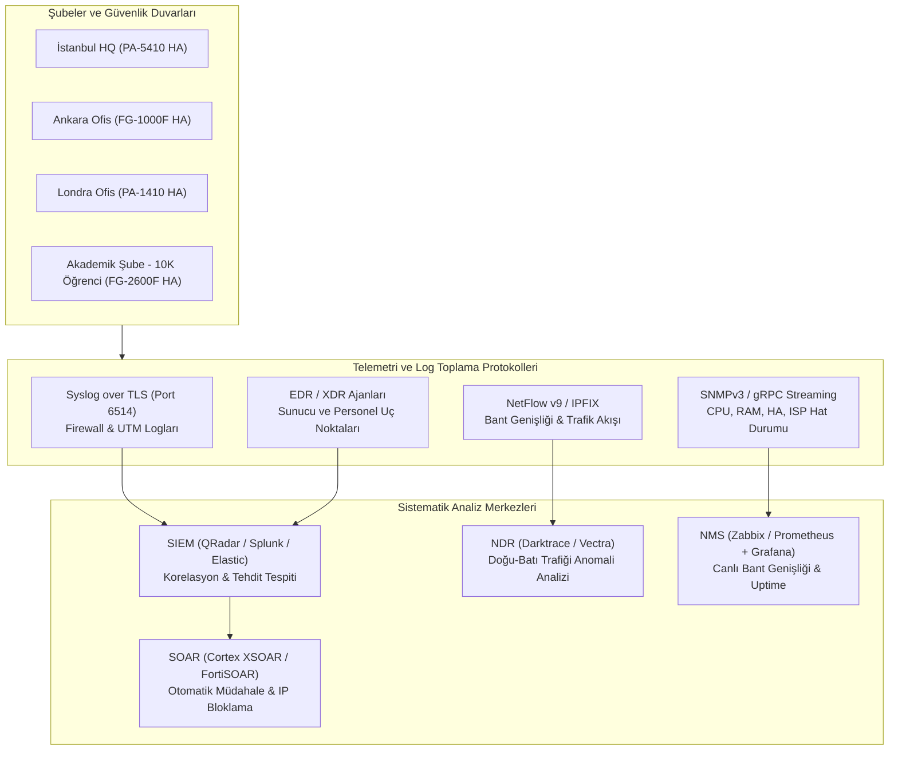

# Kurumsal Çok Şubeli Ağ Mimarisi ve NGFW Tasarımı

> Contributed by `B*** F*** Y***` ([@bfurkanyildiz](https://github.com/bfurkanyildiz)) · BGT207 Güvenlik Duvarı Çözümleri · 2026-2027 Güz midterm project.
> Student names are masked on purpose. Converted from the student's Turkish documents; the four vendor rule sets (PAN-OS / FortiOS syntax) are kept under `rulesets/`.

# Genel mimari

# Kurumsal Çok Şubeli Ağ Mimarisi, Bant Genişliği Planlaması ve Güvenlik Duvarı (NGFW) Tasarımı

> **Ders:** Bilişim Güvenliği / Ağ Güvenliği Mimari Tasarımı  
> **Proje Konusu:** Çok Lokasyonlu (İstanbul, Ankara, Londra, Akademik Kampüs) Kurumsal Yapıda Bant Genişliği Planlaması, NGFW Kurulumu, Kural Seti (Ruleset) Tasarımı ve 7/24 SOC Monitoring Mimarisi

---

## 1. Proje Özeti ve Kurumsal Mimari

Bu proje; farklı coğrafi konumlarda ofisleri (**İstanbul, Ankara, Londra**), **10.000 öğrencili büyük bir Akademik Şubesi**, **Yazılım Geliştirme** ve **Ar-Ge (R&D)** ekipleri bulunan global ölçekli bir kurumun uçtan uca ağ ve siber güvenlik mimarisini tanımlamaktadır.

### Klasör Yapısı (Repo Haritası)

Her şube ve departman yapısı kendi özel klasörü altında personel/öğrenci sayıları, bant genişliği hesaplamaları, Top 5 Güvenlik Duvarı (NGFW) tavsiyeleri, tercih edilmeme nedenleri, adım adım kurulum rehberi ve kullanım yerine özel **Firewall Kural Setleri (Ruleset)** ile detaylandırılmıştır:

```text
sirket-ag-guvenligi-projesi/
├── README.md                                      # Genel Mimari Özeti, Toplam Tablolar ve Proje Rehberi
├── 01-Istanbul-Merkez-Ofis/
│   ├── README.md                                  # Personel/Yazılım/Ar-Ge Dağılımı, Bant Genişliği, Top 5 NGFW ve Kurulum
│   └── firewall-ruleset.conf                      # İstanbul Merkez, Yazılım ve Ar-Ge İzolasyon Kural Seti
├── 02-Ankara-Ofis/
│   ├── README.md                                  # Personel/Teknik/Ar-Ge Dağılımı, Bant Genişliği, Top 5 NGFW ve Kurulum
│   └── firewall-ruleset.conf                      # Ankara Ofis, Kamu Entegrasyon ve Site-to-Site VPN Kural Seti
├── 03-Londra-Ofis/
│   ├── README.md                                  # Uluslararası Ofis Yapısı, GDPR Uyumluluğu, Top 5 NGFW ve Kurulum
│   └── firewall-ruleset.conf                      # Londra Ofis, Global Cloud/SD-WAN ve Zero-Trust Kural Seti
├── 04-Akademik-Sube/
│   ├── README.md                                  # 10.000 Öğrenci + Akademisyen + Personel Planı, Top 5 NGFW ve Kurulum
│   └── firewall-ruleset.conf                      # Kampüs Ağı (Eduroam/Öğrenci/Akademik/Lab) Kural Seti ve QoS Politikaları
└── 05-SOC-Monitoring-ve-Merkezi-Yonetim/
    ├── README.md                                  # İnsani (SOC L1/L2/L3) ve Sistematik (SIEM/SOAR/NDR) İzleme Mimarisi
    └── adım-adım-ngfw-kurulum-rehberi.md          # Tüm Şubeler İçin Standartlaştırılmış Adım Adım Güvenlik Duvarı Kurulumu
```

---

## 2. Şubeler Bazında Personel, Öğrenci, Yazılım, Teknik ve Ar-Ge Sayıları

Aşağıdaki tablo tüm şubelerdeki insan kaynağını ve ağ uç noktası (endpoint) yoğunluğunu özetlemektedir:

| Şube / Lokasyon | İdari & Operasyon Personeli | Yazılım Ekibi | Ar-Ge (R&D) Ekibi | Teknik / IT & Ağ Ekibi | Akademisyen (Hoca) | Öğrenci Sayısı | Toplam Kullanıcı | Tahmini Eşzamanlı Cihaz (BYOD Dahil) |
| :--- | :---: | :---: | :---: | :---: | :---: | :---: | :---: | :---: |
| **1. İstanbul Ofisi (Genel Merkez)** | 220 | 180 | 90 | 45 | - | - | **535** | ~1.300 Cihaz |
| **2. Ankara Ofisi (Ar-Ge & Kamu)** | 85 | 95 | 110 | 25 | - | - | **315** | ~750 Cihaz |
| **3. Londra Ofisi (Avrupa Hub)** | 60 | 45 | 25 | 15 | - | - | **145** | ~350 Cihaz |
| **4. Akademik Şube (Kampüs)** | 350 | 40 | 60 | 50 | 450 | **10.000** | **10.950** | ~18.500 Cihaz |
| **TOPLAM** | **715** | **360** | **285** | **135** | **450** | **10.000** | **11.945** | **~20.900 Cihaz** |

---

## 3. Tüm Şubeler İçin Bant Genişliği (Bandwidth) ve QoS Özeti

Bant genişliği hesaplanırken **eşzamanlılık oranı (concurrency factor)**, **uygulama profili (CI/CD, Git, Video Konferans, Akademik Veri Setleri, LMS)** ve **%30 büyüme/pik payı (headroom)** dikkate alınmıştır.

| Şube / Birim | Birincil Hat (Primary ISP) | Yedek Hat (Redundant ISP / MPLS) | Toplam Kapasite | Kritik Trafik Önceliği (QoS Sınıfı) |
| :--- | :---: | :---: | :---: | :--- |
| **İstanbul Merkez Ofis** | 5 Gbps Metro Ethernet (Simetrik) | 2 Gbps Farklı ISP Fiber | **7 Gbps** | Yazılım CI/CD, Ar-Ge Cloud Sync, Merkez VPN, VoIP |
| **Ankara Ofis** | 2.5 Gbps Metro Ethernet (Simetrik) | 1 Gbps Farklı ISP Fiber | **3.5 Gbps** | Ar-Ge Veri Transferi, Site-to-Site IPSec VPN, Kamu G2B |
| **Londra Ofis** | 1 Gbps Dedicated Leased Line | 1 Gbps Farklı Tier-1 ISP | **2 Gbps** | Global SD-WAN, Bulut Erişimi (AWS/Azure), Video Konferans |
| **Akademik Şube (10.000 Öğrenci)** | 20 Gbps ULAKBİM / Metro Ethernet | 10 Gbps Ticari ISP (Yedek) | **30 Gbps** | Akademik Araştırma (%25), LMS/Sınav (%25), Öğrenci Wi-Fi (%35), İdari (%15) |

---

## 4. Şube Bazlı Seçilen Güvenlik Duvarı (NGFW) Özeti ve Neden Diğerlerinin Tercih Edilmediği

Her şubenin klasöründe **Top 5 Güvenlik Duvarı** detaylı throughput ve maliyet analizleriyle karşılaştırılmıştır. Aşağıda her şube için **1. sırada seçilen (Tercih Edilen)** model ve **diğer 4 adayın neden tercih edilmediği** özetlenmiştir:

| Şube | Seçilen NGFW (Active-Passive HA) | Birim Fiyat (`priceUsd`) | Neden Seçildi? | Diğer Adaylar Neden Tercih Edilmedi? (Özet) |
| :--- | :--- | :---: | :--- | :--- |
| **İstanbul Merkez** | **Palo Alto PA-5410** (2x HA) | **$68,000** | 22.5 Gbps Threat Prevention, App-ID ile Yazılım/Ar-Ge mikro-segmentasyonu, gelişmiş SSL Inspection. | **FortiGate 1800F ($39,500):** Derin App-ID granülerliği PA kadar esnek değil.<br>**Check Point 6900 ($44,000):** SSL Inspection açıkken throughput düşüşü.<br>**Cisco 3130 ($46,500):** Yönetim arayüzü (FMC) karmaşıklığı.<br>**Sophos XGS 5500 ($19,400):** Veri merkezi ölçeğinde ASIC/donanım hızlandırma sınırı. |
| **Ankara Ofis** | **FortiGate 1000F** (2x HA) | **$24,500** | Yüksek IPSec VPN performansı (55 Gbps ASIC SPU), SD-WAN yerleşikliği ve fiyat/performans dengesi. | **Palo Alto PA-3430 ($42,000):** Bu ölçekte lisans maliyeti bütçe üstü.<br>**Check Point 6600 ($28,000):** SD-WAN yetenekleri ek lisans ve karmaşa yaratıyor.<br>**Cisco 3110 ($26,500):** 6.5 Gbps VPN kapasitesi DR büyümesi için sınırlı.<br>**Forcepoint 1402 ($21,000):** Yerel destek ve ekosistem entegrasyonu daha dar. |
| **Londra Ofis** | **Palo Alto PA-1410** (2x HA) | **$11,800** | İstanbul Merkez (Panorama) ile %100 uyumlu merkezi politika yönetimi, 4.6 Gbps Threat Prevention ve GlobalProtect ZTNA. | **FortiGate 400F ($12,700):** Merkezdeki Panorama ile tek ekrandan (Single Pane of Glass) yönetilememesi.<br>**Check Point 6200 ($10,500):** Küçük-orta şubede yönetim yükü.<br>**Cisco Meraki MX250 ($9,800):** Derin paket inceleme (DPI) ve özel kural yazımında kısıtlı.<br>**SonicWall NSa 4700 ($8,900):** Kurumsal SOC/SIEM entegrasyon derinliği yetersiz. |
| **Akademik Şube** | **FortiGate 3500F** (2x HA) | **$165,000** | 10.000 öğrencinin oluşturduğu milyonlarca eşzamanlı oturumu ve **30 Gbps** trafiği **63 Gbps Threat Prevention** (NP7 ASIC) ile darboğazsız işlemesi. | **Palo Alto PA-5430 ($195,000):** 38 Gbps kapasiteli ancak eğitim bütçesini aşıyor.<br>**FortiGate 2600F ($78,000):** 28 Gbps Threat Prevention hızı 30 Gbps toplam hat hızının altında kalıyor.<br>**Check Point 16200 ($135,000):** 25 Gbps hız < 30 Gbps hat.<br>**Cisco 4125 ($142,000):** 26 Gbps hız < 30 Gbps hat ve BYOD lisans maliyeti. |

---

## 5. Web Siteleri, Mobil Uygulamalar, API Gateway ve WAF Koruması

Kurumumuzun dış dünyaya açık dijital varlıkları doğrudan iç ağa (LAN) değil, **İstanbul Merkez (`VLAN 90 - 10.10.90.0/24`)** ve **Akademik Kampüs (`VLAN 490 - 10.42.90.0/24`)** üzerindeki izole **DMZ** bölgelerine yerleştirilmiştir:
* **Kurumsal Web Sitesi (`www`) ve Öğrenci Bilgi Sistemi (OBS / LMS Web Portalı):** Önünde **Cloudflare WAF (Web Application Firewall)** ve **FortiWeb** konumlandırılmıştır. OWASP Top 10 (SQLi, XSS, RCE), Layer-7 DDoS ve bot saldırılarını filtreler.
* **iOS & Android Mobil Uygulamaları (Kurumsal Mobil App & Kampüs Öğrenci Mobil App):** Mobil uygulamaların konuştuğu REST/GraphQL uç noktaları **API Gateway (`10.10.90.10` ve `10.42.90.10`)** arkasında mTLS, JWT kimlik doğrulama ve **Rate-Limiting (`limit` kuralları)** ile korunur.
* **DMZ İzolasyonu:** DMZ sunucularından iç ağa (LAN) doğru hiçbir bağlantı başlatılamaz (`DMZ -> LAN Deny`); yalnızca ters vekil sunucu (Reverse Proxy) üzerinden belirli uygulama portlarına kontrollü erişim sağlanır.

---

## 6. Operasyonel Süreçler: Yedekleme, Yama Yönetimi, Log Saklama ve Güncel CVE Takibi

* **Konfigürasyon Yedekleme (Backup & DR):** Tüm Palo Alto ve FortiGate güvenlik duvarlarının kural ve sistem konfigürasyonları her gece (`02:00`) otomatik olarak (`config-export`) şifreli Git deposuna ve S3 nesne depolama alanına yedeklenir. Ayda bir kez felaket kurtarma geri yükleme testi (Restore Drill) yapılır.
* **Yama ve Firmware Yönetimi (Patching Routine):** Üretici güvenlik bültenleri (PSIRT) günlük takip edilir. Her ayın ikinci Cumartesi gecesi düzenli **Firmware/Patch Bakım Penceresi** uygulanır; Active-Passive HA yapısı sayesinde önce Passive cihaz güncellenip test edilir, ardından kesintisiz failover ile Active cihaz güncellenir.
* **Log Saklama Süresi (Log Retention) ve Yasal Uyumluluk (5651 / KVKK / UK-GDPR / ISO 27001):** Tüm güvenlik duvarı, VPN, DHCP ve CGNAT logları SIEM üzerinde **90 gün sıcak (Hot Storage)**, **2 yıl (730 gün) TÜBİTAK KamuSM zaman damgalı soğuk arşiv (Cold Archive)** olarak saklanır.
* **Takip Edilen Güncel CVE Kayıtları (`cveWatch`):**
  1. **`CVE-2024-3400` (Palo Alto Networks PAN-OS GlobalProtect Komut Enjeksiyonu):** İlk aşamada geçici önlem (*Mitigation*) olarak Threat Prevention `95187/95189` imzaları aktif edilmiş ve cihaz telemetrisi kapatılmıştır; ardından acil bakım penceresinde kalıcı yama (*Permanent Patch*: `PAN-OS 11.1.2-h3`) uygulanmıştır (`status: patched`).
  2. **`CVE-2024-21762` (Fortinet FortiOS SSL-VPN Out-of-Bounds Write RCE):** Geçici önlem (*Mitigation*) olarak SSL-VPN web-mode kapatılmış ve uzaktan erişim yalnızca MFA zorunlu IPSec IKEv2 ile sınırlandırılmıştır; ardından Ankara ve Akademik Kampüs HA kümeleri kalıcı olarak `FortiOS 7.4.3` sürümüne yamalanmıştır (`status: patched`).


# Istanbul HQ (Software and R&D Center)


## 1. Şube Profili ve Personel / Ekip Dağılımı

İstanbul Ofisi kurumun **Genel Merkezi (HQ)** olup, ana veri merkezini (Primary Data Center), çekirdek yazılım geliştirme takımlarını ve stratejik Ar-Ge laboratuvarlarını barındırmaktadır.

| Departman / Rol | Kişi Sayısı | Ortalama Cihaz / Kişi | Toplam Uç Nokta (Endpoint) | Ağ Segmenti (VLAN) |
| :--- | :---: | :---: | :---: | :---: |
| **İdari & Operasyon Personeli** (İK, Finans, Hukuk, Satış) | 220 | 2 (PC + Mobil) | 440 | `VLAN 10` (`10.10.10.0/24`) |
| **Yazılım Geliştirme Ekibi (Software)** (Backend, Frontend, Mobile, QA) | 180 | 3 (Workstation, Test Cihazı, Mobil) | 540 | `VLAN 20` (`10.10.20.0/23`) |
| **Ar-Ge (R&D) Ekibi** (AI/ML, Kriptografi, Donanım Prototip - Proxy Egress) | 90 | 3 (GPU İstasyonu, IoT/DevBoard, PC) | 270 | `VLAN 30` (`10.10.30.0/24`) |
| **DMZ Sunucuları** (Kurumsal Web, iOS/Android Mobil API Gateway - Cloudflare WAF) | - | 15 Sunucu | 15 | `VLAN 90` (`10.10.90.0/24`) |
| **Teknik / IT, DevOps & SOC Yönetim Ağı (Management VLAN)** | 45 | 3 (Admin PC, Bastion `10.10.99.20`, SIEM) | 135 | `VLAN 99` (`10.10.99.0/24`) |
| **İç Sunucu & Veri Merkezi (Internal DC)** (ERP, GitLab, DLP Proxy, DHCP/DNS/NTP `10.10.100.5`) | - | 120 Fiziksel/Sanal Sunucu | 120 | `VLAN 100` (`10.10.100.0/24`) |
| **Misafir & IoT / Toplantı Odaları (Guest Wi-Fi)** | Değişken (~50) | 1 | 50 | `VLAN 200` (`10.10.200.0/24`) |
| **TOPLAM** | **535 Kişi** | - | **~1.570 Aktif Uç** | **Ana Blok: `10.10.0.0/16`** |

---

## 2. Bant Genişliği (Bandwidth) Tahmini ve QoS Planlaması

### Trafik Hesaplama Metodolojisi
* **Yazılım Ekibi (180 kişi):** Docker imaj çekme/itme, Git repo klonlama, CI/CD pipeline, bulut ortamları (AWS/GCP) senkronizasyonu -> Kişi başı pik **15 Mbps** -> `~2.7 Gbps`
* **Ar-Ge Ekibi (90 kişi):** Büyük yapay zeka veri setleri, simülasyon telemetrisi, akademik makale/veri kaynakları -> Kişi başı pik **20 Mbps** -> `~1.8 Gbps`
* **İdari Personel (220 kişi):** ERP, CRM, VoIP, 1080p Teams/Zoom toplantıları, e-posta -> Kişi başı pik **5 Mbps** -> `~1.1 Gbps`
* **Merkez Veri Merkezi & Şubeler Arası IPSec/SD-WAN:** Ankara, Londra ve Akademik Şube ile merkezi replikasyon -> `~1.4 Gbps`

### Önerilen Hat Kapasitesi ve Dağılımı
* **Toplam Önerilen Kapasite:** **7 Gbps** (`5 Gbps Primary Simetrik Metro Ethernet` + `2 Gbps Redundant Farklı ISP Fiber`)

| Trafik Sınıfı | Garanti Edilen Bant (Min) | Maksimum Tavan (Burst) | DSCP / Öncelik | Açıklama |
| :--- | :---: | :---: | :---: | :--- |
| **VoIP & Video Konferans** | 700 Mbps (%10) | 1.5 Gbps | `EF (46)` - Kritik | Ses ve görüntüde paket kaybı/jitter önleme |
| **Şubeler Arası VPN & DC Sync** | 1.4 Gbps (%20) | 2.5 Gbps | `AF41` - Yüksek | Ankara, Londra ve Kampüs veritabanı/AD senkronizasyonu |
| **Yazılım & DevOps (CI/CD)** | 2.0 Gbps (%28) | 4.0 Gbps | `AF31` - Yüksek | GitHub/GitLab, Container Registry, Cloud erişimi |
| **Ar-Ge (R&D) Özel Veri Hattı** | 1.5 Gbps (%22) | 3.5 Gbps | `AF21` - Orta/Yüksek | Büyük veri seti indirme/yükleme |
| **İdari & Kurumsal Web** | 1.0 Gbps (%14) | 2.0 Gbps | `BE (0)` - Standart | ERP, E-posta, Standart HTTPS |
| **Misafir Ağı (Guest Wi-Fi)** | 100 Mbps | **400 Mbps (Hard Cap)** | `CS1` - Düşük | Kişi başı 10 Mbps limitli, P2P/Torrent engelli |

---

## 3. İstanbul Merkez İçin Top 5 Güvenlik Duvarı (NGFW) Tavsiyesi

İstanbul Merkez Ofisi, **7 Gbps** internet çıkışı ve yoğun **Doğu-Batı (East-West) VLAN trafiği** (özellikle Yazılım ve Ar-Ge izolasyonu) nedeniyle yüksek **Threat Prevention** ve **SSL/TLS Decryption** kapasitesine ihtiyaç duyar.

| Sıra | Marka / Model | Firewall Throughput | Threat Prevention (IPS+AV+App) | IPSec VPN | Tahmini Kapasite Uyumu | Durum |
| :---: | :--- | :---: | :---: | :---: | :---: | :---: |
| **1** | **Palo Alto Networks PA-5410** | 42 Gbps | **22.5 Gbps** | 18 Gbps | **Mükemmel (7 Gbps hat + SSL Inspection için tam ideal)** | **TERCİH EDİLDİ (2x HA)** |
| **2** | **Fortinet FortiGate 1800F** | 198 Gbps | **21 Gbps** | 55 Gbps | Çok Yüksek (Donanımsal NP7 ASIC avantajı) | Alternatif #1 |
| **3** | **Check Point Quantum 6900** | 39 Gbps | **15 Gbps** | 12 Gbps | Yüksek (Güçlü Zero-Day SandBlast koruması) | Alternatif #2 |
| **4** | **Cisco Secure Firewall 3130** | 42 Gbps | **17 Gbps** | 14 Gbps | İyi (Cisco ISE ile entegre ağlarda uyumlu) | Alternatif #3 |
| **5** | **Sophos XGS 5500** | 75 Gbps | **13.5 Gbps** | 16 Gbps | Orta-Yüksek (Xstream SSL motoru mevcut) | Alternatif #4 |

---

## 4. Neden PA-5410 Tercih Edildi ve Diğerleri Neden Tercih Edilmedi?

### Neden Palo Alto PA-5410 Tercih Edildi?
1. **Gerçek App-ID ve User-ID Mimarisi:** Yazılım ekibinin kullandığı `git`, `docker`, `npm`, `ssh` gibi uygulamaları sadece port bazlı değil, kriptografik imza ve davranış bazlı tanır. Port 443 üzerinden tünellenen yetkisiz araçları anında yakalar.
2. **Ar-Ge Fikri Mülkiyet (IP) Koruması (DLP & Inline ML):** Ar-Ge VLAN'ından dışarıya kaynak kodu veya veri seti sızdırılmasını (Data Exfiltration) engelleyen yerleşik makine öğrenimi tabanlı DLP ve DNS Security modüllerine sahiptir.
3. **SSL/TLS Decryption Performansı:** 7 Gbps hattın tamamında TLS 1.3 şifre çözme (decryption) açıldığında dahi darboğaz yaşatmaz.

### Diğer 4 Güvenlik Duvarı Neden Tercih Edilmedi?
* **Fortinet FortiGate 1800F Neden Tercih Edilmedi?**
  * Fiyat/performans olarak çok güçlü olmasına rağmen (Ankara ve Akademik Şubede tercih edildi), İstanbul Merkez'deki **Ar-Ge ve Yazılım mikro-segmentasyonunda** uygulama katmanı (Layer 7 App-ID) granülerliği ve Zero-Trust kullanıcı doğrulama derinliği açısından Palo Alto kadar hassas politika yazım esnekliği sunmamaktadır. Ayrıca tek üreticiye (Single-Vendor) bağımlılığı kırmak için Merkez'de Palo Alto, Kampüs'te Fortinet (Defense-in-Depth) yaklaşımı benimsenmiştir.
* **Check Point Quantum 6900 Neden Tercih Edilmedi?**
  * Tehdit önleme (Threat Emulation) yetenekleri çok başarılıdır; ancak **tam SSL/TLS Inspection** aktif edildiğinde ve yüksek sayıda eşzamanlı Yazılım/CI-CD bağlantısı oluştuğunda donanım mimarisi Palo Alto'nun özel SP3 mimarisine kıyasla daha yüksek gecikme (latency) üretmektedir.
* **Cisco Secure Firewall 3130 (Firepower) Neden Tercih Edilmedi?**
  * Yönetim konsolu olan **FMC (Firewall Management Center)** üzerinde kural yazımı, log analizi ve sorun giderme (troubleshooting) süreçleri operasyonel olarak hantal kalmaktadır. DevOps ve Yazılım ekiplerinin hızlı değişiklik taleplerine (Agile firewall rule provisioning) yanıt vermekte yavaş kalmaktadır.
* **Sophos XGS 5500 Neden Tercih Edilmedi?**
  * KOBİ ve orta ölçekli kurumlarda başarılı olsa da, 500+ kişilik merkez ofis + çoklu şube BGP/OSPF yönlendirmesi ve ağır veri merkezi Doğu-Batı trafiğinde kurumsal (Enterprise-grade) SLA beklentilerini karşılamakta yetersiz kalmaktadır.

---

## 5. Adım Adım Güvenlik Duvarı Kurulum Özeti (İstanbul Merkez)

1. **Fiziksel Montaj ve HA (High Availability):** İki adet `PA-5410` cihazı farklı güç kaynaklarına (PDU A ve PDU B) bağlanarak **Active-Passive HA** modunda yapılandırılır (`HA1 Control` ve `HA2 Data` portları yedekli bağlanır).
2. **Zone (Bölge) Tanımlamaları:**
   * `UNTRUST-ISP1` & `UNTRUST-ISP2` (Dış İnternet Hatları)
   * `DMZ-PUBLIC` (Dışa açık Web/API Sunucuları)
   * `TRUST-CORP` (İdari Personel - VLAN 10)
   * `TRUST-SWE` (Yazılım Ekibi - VLAN 20)
   * `TRUST-RND` (Ar-Ge Laboratuvarı - Yüksek İzole - VLAN 30)
   * `TRUST-MGMT` (IT & SOC Yönetim Ağı - VLAN 99)
   * `VPN-BRANCHES` (Ankara, Londra, Kampüs IPSec/SD-WAN Tünelleri)
3. **Kural Setinin Uygulanması:** Aşağıdaki [`firewall-ruleset.conf`](./firewall-ruleset.conf) dosyasında yer alan kurallar uygulanır ve tüm kuralların sonunda `Implicit Deny + Log` aktif edilir.


# Ankara Office (R&D and Public Sector)


## 1. Şube Profili ve Personel / Ekip Dağılımı

Ankara Ofisi; kurumun **Savunma/Kamu Bilişim Projeleri**, yoğun **Ar-Ge (R&D) geliştirme faaliyetleri** ve İstanbul Merkez Ofis'in **Felaket Kurtarma (Disaster Recovery - DR)** yedekliliğini üstlenen stratejik şubesidir.

| Departman / Rol | Kişi Sayısı | Ortalama Cihaz / Kişi | Toplam Uç Nokta (Endpoint) | Ağ Segmenti (VLAN) |
| :--- | :---: | :---: | :---: | :---: |
| **İdari & Kamu İlişkileri Personeli** | 85 | 2 (PC + Mobil) | 170 | `VLAN 10` (`10.20.10.0/24`) |
| **Yazılım Geliştirme Ekibi (Software)** (Gömülü Sistemler, Kamu G2B) | 95 | 2.5 (Workstation, Test Cihazı) | 240 | `VLAN 20` (`10.20.20.0/24`) |
| **Ar-Ge (R&D) Ekibi** (Savunma & Siber Güvenlik - DLP Proxy Egress) | 110 | 3 (Lab PC, FPGA/Donanım, Mobil) | 330 | `VLAN 30` (`10.20.30.0/24`) |
| **Teknik / Sistem & Ağ Yönetim Ekibi (Management VLAN)** | 25 | 2.5 (Admin PC, Mobil) | 65 | `VLAN 99` (`10.20.99.0/24`) |
| **Felaket Kurtarma (DR) & Altyapı Sunucuları** (DHCP/DNS/NTP `10.20.100.5`, Proxy `10.20.100.10`) | - | 60 Sunucu | 60 | `VLAN 100` (`10.20.100.0/24`) |
| **Misafir & IoT Ağı (Guest Wi-Fi)** | Değişken (~30) | 1 | 30 | `VLAN 200` (`10.20.200.0/24`) |
| **TOPLAM** | **315 Kişi** | - | **~895 Aktif Uç** | **Ana Blok: `10.20.0.0/16`** |

---

## 2. Bant Genişliği (Bandwidth) Tahmini ve QoS Planlaması

### Trafik Hesaplama Metodolojisi
* **Ar-Ge Ekibi (110 kişi):** Ankara ofisindeki en büyük grup Ar-Ge ekibidir. İstanbul Ar-Ge merkezi ve Akademik Şube ile şifreli (IPSec) yüksek hacimli simülasyon ve veri paylaşımı yapar -> `~1.2 Gbps`
* **Yazılım Ekibi (95 kişi):** Kod depoları, derleme sunucuları (Build Servers), test ortamları -> `~750 Mbps`
* **DR (Felaket Kurtarma) Replikasyonu:** İstanbul Merkez Veri Merkezi'nden Ankara'ya sürekli veritabanı ve sanal makine senkronizasyonu -> `~800 Mbps`
* **İdari & Teknik Personel (110 kişi):** Video konferans, kamu portalları, kurumsal erişim -> `~450 Mbps`

### Önerilen Hat Kapasitesi ve Dağılımı
* **Toplam Önerilen Kapasite:** **3.5 Gbps** (`2.5 Gbps Simetrik Metro Ethernet` + `1 Gbps Farklı Operatör Fiber / MPLS Yedek`)

| Trafik Sınıfı | Garanti Edilen Bant (Min) | Maksimum Tavan (Burst) | DSCP / Öncelik | Açıklama |
| :--- | :---: | :---: | :---: | :--- |
| **Site-to-Site IPSec VPN & DR Sync** | 1.0 Gbps (%28) | 1.8 Gbps | `AF41` - Kritik | İstanbul-Ankara DR replikasyonu ve Ar-Ge veri tüneli |
| **Ar-Ge & Yazılım Trafiği** | 1.2 Gbps (%35) | 2.2 Gbps | `AF31` - Yüksek | Git, CI/CD, Araştırma veri transferi |
| **Ses & Video Konferans** | 400 Mbps (%12) | 800 Mbps | `EF (46)` - Kritik | Şubeler arası ortak mühendislik toplantıları |
| **İdari & Standart İnternet** | 700 Mbps (%20) | 1.2 Gbps | `BE (0)` - Standart | Kurumsal web, e-posta |
| **Misafir Ağı** | 50 Mbps | **200 Mbps (Hard Cap)** | `CS1` - Düşük | İzole internet çıkışı |

---

## 3. Ankara Ofisi İçin Top 5 Güvenlik Duvarı (NGFW) Tavsiyesi

Ankara ofisinde **yüksek IPSec VPN şifreleme kapasitesi** (İstanbul ile DR senkronizasyonu ve kamu kurumlarıyla güvenli tüneller) ve **yerleşik SD-WAN** yeteneği en kritik kriterdir.

| Sıra | Marka / Model | Firewall Throughput | Threat Prevention | IPSec VPN Throughput | Öne Çıkan Özellik | Durum |
| :---: | :--- | :---: | :---: | :---: | :--- | :---: |
| **1** | **Fortinet FortiGate 1000F** | 140 Gbps | **13 Gbps** | **55 Gbps** | **Donanımsal ASIC (NP7/CP9) ile rakipsiz VPN & SD-WAN** | **TERCİH EDİLDİ (2x HA)** |
| **2** | **Palo Alto Networks PA-3430** | 19 Gbps | **10.5 Gbps** | 11 Gbps | Yüksek uygulama görünürlüğü | Alternatif #1 |
| **3** | **Check Point Quantum 6600** | 32 Gbps | **9 Gbps** | 8.5 Gbps | Güçlü tehdit emülasyonu (Sandboxing) | Alternatif #2 |
| **4** | **Cisco Secure Firewall 3110** | 17 Gbps | **9 Gbps** | 6.5 Gbps | Kurumsal ağ entegrasyonu | Alternatif #3 |
| **5** | **Forcepoint NGFW 1402** | 20 Gbps | **7.5 Gbps** | 10 Gbps | Çoklu ISP kümeleme ve yüksek erişilebilirlik | Alternatif #4 |

---

## 4. Neden FortiGate 1000F Tercih Edildi ve Diğerleri Neden Tercih Edilmedi?

### Neden Fortinet FortiGate 1000F Tercih Edildi?
1. **55 Gbps Donanımsal IPSec VPN Kapasitesi:** Ankara ofisi, İstanbul Merkez'in Felaket Kurtarma (DR) merkezi olduğu için şifreli tünel üzerinden saniyede gigabitlerce veri akmaktadır. FortiGate'in özel `NP7` ağ işlemcisi, IPSec trafiğini CPU'yu yormadan donanımsal olarak şifreler.
2. **Ek Lisans Gerektirmeyen Kurumsal SD-WAN:** İki farklı ISP hattı (2.5 Gbps + 1 Gbps) arasında paket kaybı, gecikme (latency) ve jitter değerlerine göre trafiği milisaniyeler içinde yönlendiren yerleşik SD-WAN motoruna sahiptir.
3. **Maliyet Etkinliği (TCO):** 13 Gbps Threat Prevention kapasitesini rakiplerine göre %35-%40 daha düşük toplam sahip olma maliyetiyle sunar.

### Diğer 4 Güvenlik Duvarı Neden Tercih Edilmedi?
* **Palo Alto PA-3430 Neden Tercih Edilmedi?**
  * IPSec VPN throughput değeri (11 Gbps) FortiGate 1000F'in (55 Gbps) oldukça gerisindedir ve SD-WAN özellikleri için ek abonelik maliyeti çıkarmaktadır.
* **Check Point Quantum 6600 Neden Tercih Edilmedi?**
  * Yoğun DR veritabanı replikasyonu (büyük paketli sürekli IPSec akışı) sırasında IPSec + IPS birlikte açıldığında performans düşüşü yaşanmaktadır.
* **Cisco Secure Firewall 3110 Neden Tercih Edilmedi?**
  * 6.5 Gbps IPSec VPN kapasitesi gelecekteki DR büyüme projeksiyonları için sınırda kalmaktadır.
* **Forcepoint NGFW 1402 Neden Tercih Edilmedi?**
  * SD-WAN ve VPN yetenekleri güçlü olmasına rağmen, Türkiye'deki siber güvenlik uzmanı ekosistemi ve üçüncü parti SIEM/SOAR hazır entegrasyon paketleri Fortinet ve Palo Alto kadar yaygın değildir.

---

## 5. Adım Adım Güvenlik Duvarı Kurulum Özeti (Ankara Ofisi)

1. **FGCP High Availability Kurulumu:** İki adet `FortiGate 1000F` cihazı Active-Passive modda, kalp atışı (Heartbeat) portları (`ha1`, `ha2`) doğrudan çapraz bağlanarak kümelendirilir.
2. **SD-WAN Zone Yapılandırması:** `wan1` (2.5 Gbps Metro) ve `wan2` (1 Gbps Fiber) arayüzleri `virtual-wan-link` altına alınır; SLA hedefi olarak `Ping < 15ms, Jitter < 5ms, Packet Loss < %0.5` tanımlanır.
3. **Air-Gapped / İzole Ar-Ge VLAN'ı:** Savunma/Kamu projeleri geliştiren Ar-Ge personeli için `VLAN 30` oluşturulur ve dış internete doğrudan çıkışı kapatılarak yalnızca güvenli vekil sunucu (Proxy) ve izinli repo erişimi verilir.
4. **Kural Setinin Uygulanması:** [`firewall-ruleset.conf`](./firewall-ruleset.conf) içindeki FortiOS politikaları devreye alınır.


# London Office (Europe Hub)


## 1. Şube Profili ve Personel / Ekip Dağılımı

Londra Ofisi; şirketin **Avrupa ve Global pazarlara** açılan kapısı, uluslararası bulut (AWS `eu-west-2` London / Azure UK South) entegrasyon noktası ve global Ar-Ge işbirliği merkezidir. **UK-GDPR** ve **ISO/IEC 27701** veri gizliliği regülasyonlarına doğrudan tabidir.

| Departman / Rol | Kişi Sayısı | Ortalama Cihaz / Kişi | Toplam Uç Nokta (Endpoint) | Ağ Segmenti (VLAN) |
| :--- | :---: | :---: | :---: | :---: |
| **İdari, Global Satış & Hukuk (UK-GDPR)** | 60 | 2 (Laptop + Mobil) | 120 | `VLAN 10` (`10.30.10.0/24`) |
| **Yazılım Ekibi (Software)** (Cloud-Native, FinTech & SaaS) | 45 | 2.5 (MacBook Pro, Test VM) | 115 | `VLAN 20` (`10.30.20.0/24`) |
| **Ar-Ge (R&D) Ekibi** (Global AI & Kuantum Güvenlik - DLP Proxy Egress) | 25 | 3 (Workstation, Mobil) | 75 | `VLAN 30` (`10.30.30.0/24`) |
| **Teknik / CloudOps & Ağ Yönetim Ekibi (Management VLAN)** (DHCP/DNS/NTP `10.30.99.5`) | 15 | 2.5 (Admin Laptop, Mobil) | 40 | `VLAN 99` (`10.30.99.0/24`) |
| **Misafir & Toplantı Odası Ağı (Guest Wi-Fi & IoT)** | Değişken (~20) | 1 | 20 | `VLAN 200` (`10.30.200.0/24`) |
| **TOPLAM** | **145 Kişi** | - | **~370 Aktif Uç** | **Ana Blok: `10.30.0.0/16`** |

---

## 2. Bant Genişliği (Bandwidth) Tahmini ve QoS Planlaması

### Trafik Hesaplama Metodolojisi
* **Bulut (AWS/Azure UK) ve SaaS Trafiği:** Londra ofisi yerel fiziksel sunucu barındırmak yerine **%90 Cloud-Native** çalışır. Sürekli AWS/Azure VPC bağlantıları ve SaaS trafiği -> `~800 Mbps`
* **İstanbul & Ankara ile Global VPN:** Düşük gecikmeli (Low-latency) uluslararası IPSec/SD-WAN bağlantısı -> `~400 Mbps`
* **4K/1080p Global Video Konferans & Müşteri Sunumları:** -> `~300 Mbps`

### Önerilen Hat Kapasitesi ve Dağılımı
* **Toplam Önerilen Kapasite:** **2 Gbps** (`1 Gbps BTnet Dedicated Leased Line` + `1 Gbps Virgin Media Business Fiber Yedek`)

| Trafik Sınıfı | Garanti Edilen Bant (Min) | Maksimum Tavan (Burst) | DSCP / Öncelik | Açıklama |
| :--- | :---: | :---: | :---: | :--- |
| **Global Video Konferans & VoIP** | 300 Mbps (%15) | 600 Mbps | `EF (46)` - Kritik | İstanbul-Londra-Müşteri canlı görüşmeleri |
| **AWS/Azure Direct & CloudOps** | 800 Mbps (%40) | 1.5 Gbps | `AF41` - Yüksek | Yazılım ve Ar-Ge bulut iş yükleri |
| **İstanbul HQ IPSec/SD-WAN Tüneli** | 400 Mbps (%20) | 800 Mbps | `AF31` - Yüksek | Kurumsal iç kaynaklara ve GitLab'a erişim |
| **İdari & Kurumsal Web** | 400 Mbps (%20) | 800 Mbps | `BE (0)` - Standart | CRM, Office 365, Web |
| **Misafir Ağı** | 50 Mbps | **100 Mbps (Hard Cap)** | `CS1` - Düşük | İzole internet |

---

## 3. Londra Ofisi İçin Top 5 Güvenlik Duvarı (NGFW) Tavsiyesi

Londra ofisi için en önemli kriter; **İstanbul Merkez Ofis'teki Palo Alto Panorama merkezi yönetim konsoluna doğrudan bağlanabilmesi**, **UK-GDPR veri sızıntısı önleme (DLP)** kurallarını desteklemesi ve hibrit çalışanlar için **Zero-Trust Network Access (ZTNA)** sağlamasıdır.

| Sıra | Marka / Model | Firewall Throughput | Threat Prevention | IPSec VPN | Öne Çıkan Özellik | Durum |
| :---: | :--- | :---: | :---: | :---: | :--- | :---: |
| **1** | **Palo Alto Networks PA-1410** | 8.8 Gbps | **4.6 Gbps** | 4.1 Gbps | **İstanbul HQ (Panorama) ile %100 Merkezi Yönetim & ZTNA** | **TERCİH EDİLDİ (2x HA)** |
| **2** | **Fortinet FortiGate 400F** | 79 Gbps | **9 Gbps** | 55 Gbps | Çok yüksek donanım performansı | Alternatif #1 |
| **3** | **Check Point Quantum 6200** | 17 Gbps | **3.6 Gbps** | 3.2 Gbps | Gelişmiş DLP ve GDPR raporlama | Alternatif #2 |
| **4** | **Cisco Meraki MX250** | 4 Gbps | **2 Gbps** | 1 Gbps | Bulut tabanlı kolay kurulum (Zero-touch) | Alternatif #3 |
| **5** | **SonicWall NSa 4700** | 18 Gbps | **5.2 Gbps** | 6 Gbps | Uygun maliyetli derin bellek incelemesi (RTDMI) | Alternatif #4 |

---

## 4. Neden PA-1410 Tercih Edildi ve Diğerleri Neden Tercih Edilmedi?

### Neden Palo Alto PA-1410 Tercih Edildi?
1. **İstanbul Merkez ile Tek Ekrandan Yönetim (Panorama):** Londra'da sadece 15 kişilik bir CloudOps/Teknik ekip vardır. Güvenlik politikalarının İstanbul'daki Merkez SOC ekibi tarafından **Palo Alto Panorama** üzerinden merkezi olarak basılması operasyonel hata riskini sıfırlar.
2. **UK-GDPR ve Veri Egemenliği (Data Sovereignty):** Avrupa Birliği / İngiltere vatandaşlarına ait kişisel verilerin (PII) Türkiye'ye veya yetkisiz bulut bölgelerine aktarılmasını engelleyen yerleşik **Enterprise DLP** filtreleri sunar.
3. **GlobalProtect ZTNA:** Londra'daki 145 çalışanın hibrit/uzaktan çalışma senaryosunda cihaz sağlık kontrolü (HIP Check - Disk şifreli mi, EDR aktif mi?) yaparak ağa almasını sağlar.

### Diğer 4 Güvenlik Duvarı Neden Tercih Edilmedi?
* **Fortinet FortiGate 400F Neden Tercih Edilmedi?**
  * Donanımsal olarak çok güçlü olsa da, İstanbul Genel Merkez'de Palo Alto kullanıldığı için Londra-İstanbul arasındaki uygulama tabanlı SD-WAN/AutoVPN ve merkezi kural senkronizasyonunda `PA-1410` kadar kusursuz entegrasyon sağlamaz.
* **Check Point Quantum 6200 Neden Tercih Edilmedi?**
  * Üçüncü bir firewall üreticisini (Palo Alto ve Fortinet'in yanına Check Point) mimariye dahil etmek SOC ekibinin eğitim, bakım ve korelasyon yükünü gereksiz yere artıracaktır.
* **Cisco Meraki MX250 Neden Tercih Edilmedi?**
  * Buluttan yönetimi çok kolaydır ancak **SSL/TLS Decryption (Deep Packet Inspection)** desteği ve granüler Ar-Ge/Yazılım kural yazım yetenekleri kurumsal NGFW seviyesinde değildir.
* **SonicWall NSa 4700 Neden Tercih Edilmedi?**
  * Kurumsal BGP/SD-WAN yönlendirme derinliği ve gelişmiş SIEM/SOAR otomasyon entegrasyonları Palo Alto ekosistemine kıyasla zayıf kalmaktadır.

---

## 5. Adım Adım Güvenlik Duvarı Kurulum Özeti (Londra Ofisi)

1. **Zero-Touch Provisioning (ZTP):** Cihazlar Londra ofisinde kabine monte edilip internete bağlandığında, otomatik olarak İstanbul'daki **Panorama** yönetim sunucusuna kayıt olur ve şablon konfigürasyonu çeker.
2. **GDPR Veri Sınırlandırma Kuralı:** Londra veritabanlarından Türkiye veya diğer bölgelere ham müşteri verisi (PII) çıkışı DLP kurallarıyla sınırlandırılır; sadece anonimleştirilmiş telemetri ve kaynak kod transferine izin verilir.
3. **Kural Setinin Uygulanması:** [`firewall-ruleset.conf`](./firewall-ruleset.conf) içindeki kurallar devreye alınır.


# Academic Campus (10,000 students)


## 1. Şube Profili ve Öğrenci / Akademisyen / Personel Dağılımı

Akademik Şube; **10.000 öğrencisi**, **450 öğretim üyesi/hocası**, idari personeli, yazılım ve akademik Ar-Ge laboratuvarlarıyla en yüksek eşzamanlı cihaz (BYOD) yoğunluğuna ve en karmaşık güvenlik gereksinimlerine sahip kampüs yapısıdır.

> [!IMPORTANT]
> Kampüs ağlarında en büyük tehdit **içeriden (Internal / Insider Threat)** gelir: 10.000 öğrencinin kişisel bilgisayarları ve telefonları (BYOD), zararlı yazılımlar, torrent/P2P trafiği, sınav/OBS sistemlerine yönelik DDoS veya yetkisiz erişim denemeleri açısından **Sıfır Güven (Zero-Trust)** prensibiyle tamamen izole edilmelidir.

| Grup / Rol | Kişi Sayısı | Ortalama Cihaz / Kişi | Toplam Eşzamanlı Cihaz | Ağ Segmenti (VLAN - `10.40.0.0/14` İçinde) |
| :--- | :---: | :---: | :---: | :---: |
| **Öğrenciler (Lisans & Lisansüstü)** | **10.000** | 1.6 (Telefon + Laptop) | **~16.000 Cihaz** | `VLAN 400` (`10.40.0.0/16` - Öğrenci Wi-Fi / Eduroam, 65.534 IP) |
| **Bilgisayar Laboratuvarları (Öğrenci Lab)** | - | 600 Sabit PC | **600 Cihaz** | `VLAN 420` (`10.42.0.0/22`) |
| **Akademisyenler (Hocalar / Araştırmacılar)** | **450** | 2.5 (Ofis PC, Laptop, Mobil) | **~1.125 Cihaz** | `VLAN 430` (`10.42.4.0/22`) |
| **Kampüs İdari Personeli** (Öğrenci İşleri, Mali İşler, Kütüphane) | **350** | 1.5 (PC + Mobil) | **~525 Cihaz** | `VLAN 440` (`10.42.8.0/23`) |
| **Akademik Ar-Ge & Teknokent Ekibi (R&D)** | **60** | 3 (Süper Bilgisayar/Lab) | **180 Cihaz** | `VLAN 450` (`10.42.10.0/24`) |
| **Kampüs Yazılım Ekibi (Software)** (OBS, LMS, Mobil App) | **40** | 2.5 | **100 Cihaz** | `VLAN 460` (`10.42.11.0/24`) |
| **Kampüs Misafir & Akıllı Kampüs IoT/Kamera Ağı (Guest & IoT)** | - | ~300 Kamera/Sensör/Misafir | **300 Cihaz** | `VLAN 480` (`10.42.12.0/22`) |
| **Kampüs DMZ** (OBS, LMS & Online Sınav Web/Mobil API - WAF Arkasında) | - | 25 Sunucu | **25 Sunucu** | `VLAN 490` (`10.42.90.0/24`) |
| **Teknik / Kampüs IT & Ağ Yönetim Ekibi (Management VLAN)** | **50** | 2.5 | **125 Cihaz** | `VLAN 499` (`10.42.99.0/24`) |
| **Kampüs İç Veri Merkezi (Internal DC & DB)** (DHCP/DNS/NTP `10.42.100.5`) | - | 150 Sunucu | **150 Sunucu** | `VLAN 500` (`10.42.100.0/24`) |
| **TOPLAM** | **10.950 Kişi** | - | **~19.130 Aktif Uç** | **Ana Blok: `10.40.0.0/14`** |

---

## 2. Bant Genişliği (Bandwidth) Tahmini ve QoS (Trafik Şekillendirme) Planlaması

### 10.000 Öğrenci İçin Bant Genişliği Hesabı
* **Öğrenci Profili (10.000 Öğrenci / ~16.000 Cihaz):** Aynı anda kampüste aktif olma oranı (Peak Concurrency) %60 (~6.000 aktif öğrenci) kabul edildiğinde; online ders videoları, akademik araştırmalar, sosyal medya ve bulut kullanımı için öğrenci başına ortalama **2.5 - 3 Mbps** aktif akış gerekir -> `~16 - 18 Gbps`
* **Akademisyenler (450 Hoca) & Akademik Ar-Ge (60 Kişi):** ULAKBİM, CERN/IEEE veri tabanları, uluslararası konferans yayınları, büyük veri setleri -> `~5 Gbps`
* **İdari Personel (350 Kişi), Yazılım (40 Kişi) & OBS/LMS Sunucuları:** Uzaktan eğitim yayınları, sınav sistemleri -> `~4 Gbps`
* **Büyüme ve Pik Payı (Headroom):** `~3 Gbps`

### Önerilen Hat Kapasitesi ve Dağılımı
* **Toplam Önerilen Kapasite:** **30 Gbps** (`20 Gbps ULAKBİM / Akademik Metro Ethernet` + `10 Gbps Ticari ISP Yedek Hat`)

| Kullanıcı / Trafik Grubu | Garanti Edilen Bant (Min) | Maksimum Tavan (Burst) | Kişi Başı Limit (Per-IP Shaper) | QoS Politikası ve Kısıtlamalar |
| :--- | :---: | :---: | :---: | :--- |
| **OBS, LMS (Online Sınav/Ders) & Sunucular** | **6 Gbps (%20)** | 10 Gbps | Yok (Sunucu) | `EF / AF41` - Sınav dönemlerinde en yüksek öncelik |
| **Akademisyenler (450 Hoca) & Ar-Ge (60)** | **6 Gbps (%20)** | 10 Gbps | **100 Mbps / kullanıcı** | `AF31` - Akademik veritabanları ve yayınlar öncelikli |
| **Kampüs Yazılım (40) & Teknik IT (50)** | **2 Gbps (%7)** | 4 Gbps | **200 Mbps / kullanıcı** | `AF31` - Git, Cloud, Sistem güncellemeleri |
| **İdari Personel (350 Kişi)** | **3 Gbps (%10)** | 5 Gbps | **50 Mbps / kullanıcı** | `AF21` - YÖK/E-Devlet entegrasyonu, kurumsal işler |
| **10.000 Öğrenci (Wi-Fi & Lab)** | **13 Gbps (%43)** | **18 Gbps (Hard Cap)** | **15 Mbps Download / 5 Mbps Upload** | `BE / CS1` - **Torrent/P2P, Kripto Madenciliği, VPN Bypass tamamen engelli.** Steam/Oyun güncellemeleri mesai saatlerinde (08:30-17:30) 1 Mbps ile sınırlandırılır. |

---

## 3. Akademik Şube İçin Top 5 Güvenlik Duvarı (NGFW) Tavsiyesi

10.000 öğrencinin (~18.800 cihaz) aynı anda oluşturacağı **milyonlarca eşzamanlı oturum (Concurrent TCP/UDP/QUIC Sessions)**, **CGNAT (Carrier-Grade NAT / PBA)** loglaması (5651 sayılı kanun uyumu) ve **30 Gbps** internet trafiği için donanımsal hızlandırmaya (ASIC) sahip üst düzey bir şasi/cihaz gereklidir.

| Sıra | Marka / Model | Firewall Throughput | Threat Prevention | Eşzamanlı Oturum (Concurrent Sessions) | Saniyede Yeni Oturum (New Sessions/sec) | Durum |
| :---: | :--- | :---: | :---: | :---: | :---: | :---: |
| **1** | **Fortinet FortiGate 2600F** | 198 Gbps | **28 Gbps** | **24 Milyon** | **1.000.000 / sn** | **TERCİH EDİLDİ (2x HA)** |
| **2** | **Palo Alto Networks PA-5430** | 70 Gbps | **38 Gbps** | 15 Milyon | 465.000 / sn | Alternatif #1 |
| **3** | **Check Point Quantum 16200** | 72 Gbps | **25 Gbps** | 18 Milyon | 380.000 / sn | Alternatif #2 |
| **4** | **Cisco Secure Firewall 4125** | 80 Gbps | **26 Gbps** | 15 Milyon | 350.000 / sn | Alternatif #3 |
| **5** | **Juniper SRX4600** | 95 Gbps | **22 Gbps** | 20 Milyon | 450.000 / sn | Alternatif #4 |

---

## 4. Neden FortiGate 2600F Tercih Edildi ve Diğerleri Neden Tercih Edilmedi?

### Neden Fortinet FortiGate 2600F Tercih Edildi?
1. **Saniyede 1 Milyon Yeni Oturum ve 24 Milyon Eşzamanlı Oturum Kapasitesi:** Sabah 09:00'da dersler başladığında 10.000 öğrencinin telefon ve bilgisayarları aynı anda Wi-Fi ağına bağlanıp yüzlerce HTTP/3, QUIC ve TLS bağlantısı açar (Session Storm). `FortiGate 2600F`, üzerindeki `NP7` ve `CP9` donanım işlemcileri sayesinde bu oturum patlamasını %10'un altında CPU kullanımıyla karşılar.
2. **5651 Sayılı Kanun ve CGNAT (Port Block Allocation) Performansı:** 10.000 öğrencinin internete çıkarken hangi gerçek IP ve hangi kaynak port bloğunu kullandığını donanımsal olarak loglar.
3. **Eğitim Kurumu Bütçe Verimliliği:** 30 Gbps kapasiteli bir kampüs ağında Palo Alto muadiline göre yarı yarıya daha ekonomik lisanslama sunar.

### Diğer 4 Güvenlik Duvarı Neden Tercih Edilmedi?
* **Palo Alto PA-5430 Neden Tercih Edilmedi?**
  * Teknik olarak çok üstün bir cihazdır ancak 30 Gbps kapasitede eğitim/kampüs bütçesi için donanım + yıllık abonelik maliyeti çok yüksektir. Ayrıca saniyede yeni oturum açma hızı (465K/sn), 10.000 öğrencilik ani Wi-Fi bağlantı fırtınalarında FortiGate 2600F'in (1M/sn) gerisindedir.
* **Check Point Quantum 16200 Neden Tercih Edilmedi?**
  * Yoğun Per-IP Traffic Shaping (10.000 öğrenciye ayrı ayrı 15 Mbps limit uygulama) ve CGNAT işlemleri aktif edildiğinde CPU yükü belirgin şekilde artmaktadır.
* **Cisco Secure Firewall 4125 Neden Tercih Edilmedi?**
  * Kampüs ortamında uygulama bazlı bant genişliği kısıtlama (ör. mesai saatinde Steam/Torrent kısıtlama ama YouTube Eğitim videolarına izin verme) politikaları FortiOS kadar esnek ve pratik değildir.
* **Juniper SRX4600 Neden Tercih Edilmedi?**
  * L3/L4 yönlendirme ve kampüs omurgasında çok güçlüdür ancak Layer 7 Web Filtering, öğrenci içerik filtreleme ve kullanıcı kimlik doğrulama (802.1X / Captive Portal) entegrasyonunda FortiGate kadar zengin hazır şablonlara sahip değildir.

---

## 5. Adım Adım Güvenlik Duvarı Kurulum Özeti (Akademik Şube)

1. **100G/40G Omurga Bağlantısı:** İki adet `FortiGate 2600F` cihazı, kampüs çekirdek anahtarlarına (Core Switches) `40GbE / 100GbE QSFP+` LACP port-channel ile yedekli bağlanır.
2. **802.1X & RADIUS (Eduroam) Entegrasyonu:** Öğrenciler ve akademisyenler Wi-Fi ağına bağlandığında kimlik bilgileri RADIUS üzerinden doğrulanır; `FortiGate RSSO (RADIUS Single Sign-On)` ile kullanıcının **Öğrenci mi, Hoca mı, İdari Personel mi** olduğu otomatik algılanarak ilgili güvenlik kuralına düşürülür.
3. **Sınav ve OBS Koruma Duvarı (Internal WAF & IPS):** Öğrenci VLAN'ından Kampüs Veri Merkezi'ndeki (`VLAN 500`) Öğrenci Bilgi Sistemi (OBS) ve Not Veritabanına yalnızca **HTTPS (443)** portundan ve **WAF/IPS denetiminden** geçerek erişilebilir; SSH, RDP ve veritabanı portları öğrenci ağından tamamen bloklanır.
4. **Kural Setinin Uygulanması:** [`firewall-ruleset.conf`](./firewall-ruleset.conf) dosyasında yer alan kurallar uygulanır.


# SOC ve izleme


> **Soru:** *"Monitör etmek için bu yapıyı nasıl bir çözümümüz olacak? İnsani kısmı, sistematik kısmı ve profesyonel dünyada nasıl monitör edilir?"*

İstanbul, Ankara, Londra ve 10.000 öğrencili Akademik Şubeden oluşan bu ölçekteki bir yapıda saniyede yaklaşık **25.000 - 40.000 olay kaydı (EPS - Events Per Second)** üretilir. Profesyonel siber güvenlik ve ağ dünyasında bu yapı **Sistematik (Teknolojik Otomasyon)** ve **İnsani (SOC & NOC Organizasyonu)** olmak üzere iki ayrılmaz sütun üzerinde **PPT (People, Process, Technology)** çerçevesinde izlenir.

---

## 1. Sistematik Kısım (Teknolojik İzleme Katmanları)

Profesyonel dünyada "tek bir ekran" yeterli değildir; **Ağ Performansı (NOC)** ve **Siber Güvenlik (SOC)** verileri 4 farklı sistematik katmanda toplanır:



### A. Siber Güvenlik İzleme: SIEM + SOAR (Log ve Olay Korelasyonu)
* **Kullanılan Araçlar:** IBM QRadar, Splunk Enterprise Security, Microsoft Sentinel veya Wazuh/ELK Stack.
* **Nasıl Çalışır?**
  1. Tüm şubelerdeki Palo Alto ve FortiGate güvenlik duvarları, her bağlantıyı **TLS şifreli Syslog (Port 6514)** ile İstanbul Merkez'deki Log Collector sunucularına (ve yedek olarak Ankara DR'a) gönderir.
  2. **Korelasyon Kuralları (Use-Cases):**
     * *Örnek 1 (Akademik Şube):* Öğrenci Wi-Fi ağındaki bir IP adresinden 1 dakika içinde Kampüs OBS sunucusuna 50 adet hatalı giriş (`HTTP 401/403`) veya SQL Injection imzası gelirse -> **SOAR** devreye girer ve `FortiGate 2600F` API'sine komut göndererek o öğrencinin MAC/IP adresini 24 saatliğine karantinaya alır.
     * *Örnek 2 (Ar-Ge Veri Sızıntısı):* Ankara veya İstanbul Ar-Ge VLAN'ındaki bir bilgisayardan mesai saatleri dışında (gece 03:00) dış dünyaya 5 GB boyutunda şifreli trafik çıkışı tespit edilirse -> Anında Kritik Alarm üretilir ve port kesilir.
     * *Örnek 3 (Impossible Travel):* Bir yazılımcının hesabı saat 14:00'te İstanbul Ofis'ten GitLab'a girip, saat 14:15'te Londra veya başka bir ülkeden VPN bağlantısı açarsa -> Hesap otomatik askıya alınır.

### B. Ağ Trafiği ve Bant Genişliği İzleme: NetFlow / IPFIX & NMS
* **Kullanılan Araçlar:** Zabbix / PRTG, Prometheus + Grafana, SolarWinds NetFlow Traffic Analyzer.
* **Nasıl Çalışır?**
  1. **SNMPv3 / Streaming Telemetry:** Her 30 saniyede bir tüm güvenlik duvarlarının CPU, RAM, Oturum Sayısı (Session Count), Fan/Sıcaklık, HA Senkronizasyon durumu ve ISP hatlarının doluluk oranı (`7 Gbps`, `3.5 Gbps`, `2 Gbps`, `30 Gbps`) çekilir ve **Grafana** panellerinde görselleştirilir.
  2. **NetFlow v9 / IPFIX:** "Şu an Ankara ofisinin 2.5 Gbps hattını kim, hangi uygulamayla dolduruyor?" sorusuna saniyeler içinde yanıt verir (Top Talkers analizi).

### C. Ağ İçi Davranış Analizi: NDR (Network Detection & Response)
* **Kullanılan Araçlar:** Darktrace, Vectra AI veya ExtraHop.
* **Neden Gerekli?** Güvenlik duvarları 주로 Kuzey-Güney (İnternet <-> İç Ağ) ve VLAN'lar arası trafiği görür. NDR ise Switch'lerden aldığı **SPAN / Port Mirroring** trafiği ile Ar-Ge ve Yazılım ağlarındaki normal davranışı makine öğrenimiyle öğrenir; sıfırıncı gün (Zero-Day) fidye yazılımı yayılımını (Lateral Movement) yakalar.

---

## 2. İnsani Kısım (7/24 SOC ve NOC Organizasyonu)

Dünyanın en iyi SIEM ve NGFW sistemleri kurulsa bile, alarmları yorumlayacak, yanlış pozitifleri (False Positive) eleyecek ve kriz anında karar verecek **insan organizasyonu** olmadan güvenlik sağlanamaz.

### Profesyonel 7/24 Vardiya ve Rol Dağılımı (İstanbul Merkez SOC + Ankara Yedek SOC)

7/24 kesintisiz izleme için **3 Vardiya (08:00-16:00, 16:00-00:00, 00:00-08:00)** + yedek izin vardiyası olmak üzere aşağıdaki ekip yapısı kurulur:

| Rol / Kademe | Kişi Sayısı | Temel Sorumlulukları (İnsani Süreç) | Müdahale Süresi (SLA) |
| :--- | :---: | :--- | :---: |
| **SOC L1 Analisti (Triaj & Gözlem)** | 6 Kişi (Her vardiyada 2 kişi) | SIEM ekranındaki alarmları 7/24 izler. Gelen alarmın gerçek bir saldırı mı yoksa yanlış alarm mı (False Positive) olduğunu **15 dakika içinde** sınıflandırır (Triage). Bilinen olaylar için Playbook uygular. | **< 15 Dakika** |
| **SOC L2 Analisti (Olay Müdahale - IR)** | 4 Kişi | L1'in çözemediği karmaşık saldırıları inceler. Derin paket analizi (PCAP), zararlı yazılım tersine mühendisliği, Ar-Ge/Yazılım sunucularında adli bilişim (Forensics) incelemesi yapar. | **< 30 Dakika** |
| **SOC L3 / Threat Hunter (Tehdit Avcısı)** | 2 Kişi | Alarm gelmesini **beklemez**. Hipotez kurarak (ör. *"Londra veya Akademik ağda gizlenmiş bir APT grubu var mı?"*) logların içinde proaktif tehdit avcılığı yapar ve yeni SIEM kuralları yazar. | Proaktif / Sürekli |
| **NOC / Ağ Güvenliği Mühendisi** | 4 Kişi | Güvenlik duvarlarının (Palo Alto & FortiGate) versiyon güncellemelerini, HA testlerini, yeni kural taleplerini, BGP/SD-WAN hat kesintilerini ve bant genişliği darboğazlarını yönetir. | **< 15 Dakika** |
| **SOC Yöneticisi / CISO** | 1 Kişi | Kriz yönetimi, UK-GDPR / KVKK yasal bildirim süreçleri, yönetim kurulu raporlaması ve tatbikat (Red Team / Purple Team) planlamasını yönetir. | Stratejik |

---

## 3. İnsani ve Sistematik Kısmın Birleşimi: Gerçek Bir Olay Senaryosu (Playbook)

Profesyonel dünyada sistem ve insanın nasıl birlikte çalıştığını gösteren örnek akış:

1. **Saat 02:14 (Sistematik Tespit):** Akademik Şubede (`FortiGate 2600F`) öğrenci yurdundan bağlanan bir bilgisayar, kampüs içindeki sunuculara saniyede 5.000 port taraması (Port Scan) ve ardından SMB Brute-Force denemesi başlatır.
2. **Saat 02:14:05 (Otomatik SOAR Aksiyonu):** FortiGate IPS saldırıyı bloklar, logu SIEM'e iletir. SOAR otomatik olarak öğrencinin ağ portunu (Switch 802.1X CoA ile) **Karantina VLAN'ına** alır.
3. **Saat 02:16 (İnsani L1 Analizi):** Gece vardiyasındaki **SOC L1 Analisti**, SIEM ekranına düşen alarmı inceler. Öğrencinin sadece kendi bilgisayarında mı virüs olduğunu, yoksa aynı yurttaki diğer öğrencilere de bulaşıp bulaşmadığını kontrol eder.
4. **Saat 02:25 (İnsani L2 Müdahalesi):** L2 Analisti, saldıran cihazın kampüs yazılım ekibinden çalınmış bir VPN sertifikası kullanmaya çalıştığını fark eder. İlgili sertifikayı iptal eder (Revoke) ve sabah için Kampüs IT ekibine detaylı olay raporu (Incident Report) açar.

---

## 4. Alarm Yorgunluğunu (Alert Fatigue) Önleme Prensipleri

İnsani kısmın en büyük düşmanı **Alarm Yorgunluğudur** (günde 10.000 gereksiz alarm düşerse analist gerçek saldırıyı kaçırır). Bunu önlemek için:
* Rutin engellemeler (ör. dış internetten gelen sıradan port taramaları) sadece rapora yazılır, analiste **sesli/kritik alarm** olarak düşürülmez.
* Her hafta Cuma günü L2 ve L3 analistler **"Rule Tuning"** toplantısı yaparak gereksiz alarm üreten SIEM ve IPS kurallarını optimize eder.
* Ayda bir kez **Mor Takım (Purple Team)** tatbikatı yapılarak hem güvenlik duvarı kurallarının hem de SOC ekibinin reaksiyon süresi test edilir.


# Adım adım NGFW kurulumu


Bu doküman; **İstanbul, Ankara, Londra ve Akademik Şubelerimize** güvenlik duvarlarının kutudan çıkarılmasından (Day-0), kural setlerinin yazılıp 7/24 SOC izlemesine bağlanmasına (Day-2) kadar olan **standartlaştırılmış 8 adımlı kurumsal kurulum prosedürüdür**.

---

## Adım 1: Fiziksel Kurulum, Güç Yedekliliği ve Out-of-Band (OOB) Yönetim
1. Her şube için **2 adet NGFW cihazı** (Active-Passive High Availability için) sistem odasındaki farklı kabinetlere veya farklı güç dağıtım ünitelerine (`PDU-A` ve `PDU-B` - çift UPS hattı) monte edilir.
2. Cihazların `MGMT (Management)` portları, kullanıcı trafiğinden tamamen bağımsız olan **Yönetim Ağına (`VLAN 99`)** bağlanır.
3. Konsol portları, ana internet kesilse bile cihazlara LTE/4G üzerinden erişebilmek için **Console Server (Opengear / Perle)** cihazlarına bağlanır.

## Adım 2: İşletim Sistemi Sertleştirme (Hardening - Day 0)
1. Cihazların fabrika çıkışı işletim sistemleri (PAN-OS / FortiOS), üreticinin önerdiği **Long-Term Support (LTS) / Gold Star** kararlı sürümüne yükseltilir.
2. Varsayılan `admin` hesabı devre dışı bırakılır veya adı değiştirilir; yerine **RADIUS / TACACS+ + MFA (Çok Faktörlü Kimlik Doğrulama)** destekli kişisel yönetici hesapları tanımlanır.
3. Yönetim arayüzlerine (HTTPS ve SSH) yalnızca **IT/SOC Bastion (`10.10.99.20`)** IP adresinden erişime izin verilir (`Trusted Hosts`).
4. HTTP, Telnet, SNMPv1/v2c gibi şifresiz protokoller tamamen kapatılır.

## Adım 3: High Availability (HA - Yüksek Erişilebilirlik) Kümeleme
1. Birinci cihaz **Active (Primary)**, ikinci cihaz **Passive (Secondary)** olarak yapılandırılır.
2. İki cihaz arasındaki `HA1 (Control/Heartbeat)` ve `HA2 (Session Synchronization)` portları fiber/bakır kablolarla yedekli olarak birbirine bağlanır.
3. **Stateful Failover** aktif edilir: Aktif cihaz arızalandığında; İstanbul, Ankara, Londra veya 10.000 öğrencili kampüsteki açık olan VPN ve TCP oturumları kopmadan **< 1 saniye** içinde yedek cihaza devredilir.

## Adım 4: Ağ Segmentasyonu (Zone ve VLAN Mimarisi)
Tüm şubelerde standart **Zero-Trust Zone** mimarisi oluşturulur:
* **UNTRUST (WAN):** ISP 1 ve ISP 2 dış internet hatları (SD-WAN kümesi).
* **DMZ:** Dış dünyadan erişilen sunucular (Web, OBS, API Gateway).
* **TRUST-CORP:** İdari personel ağı.
* **TRUST-SWE:** Yazılım geliştirme ekibi ağı.
* **TRUST-RND:** Ar-Ge ekibi ağı (En yüksek izolasyon ve DLP).
* **TRUST-STUDENT (Sadece Akademik Şube):** 10.000 öğrencinin BYOD/Wi-Fi ağı.
* **TRUST-FACULTY (Sadece Akademik Şube):** 450 akademisyenin ağı.
* **TRUST-MGMT:** IT ve SOC yönetim ağı.

## Adım 5: Şubeler Arası IPSec VPN ve SD-WAN Kurulumu
1. İstanbul Merkez (Hub) ile Ankara, Londra ve Akademik Şube arasında **IKEv2 + AES-256-GCM + Diffie-Hellman Grup 20 (ECDH-384)** kriptografik standartlarında **Full-Mesh IPSec VPN** tünelleri kurulur.
2. **Dinamik Yönlendirme (BGP over IPSec):** Bir şubenin birincil internet hattı koptuğunda, BGP rotaları otomatik güncellenerek trafik yedek ISP hattı üzerinden kesintisiz akmaya devam eder.

## Adım 6: SSL/TLS Decryption ve Güvenlik Profillerinin Aktif Edilmesi
1. Kurumsal Active Directory (PKI) üzerinden üretilen **Alt Kök Sertifikası (Sub-CA)** güvenlik duvarlarına yüklenir ve grup politikası (GPO / MDM) ile şirket bilgisayarlarına dağıtılır.
2. Böylece şifreli HTTPS (TLS 1.3) trafiği güvenlik duvarında açılarak içine gizlenmiş zararlı yazılımlar (**Antivirus, IPS, WildFire/Sandbox**) ve veri sızıntıları (**DLP**) incelenir. *(Not: Finans/Bankacılık ve Sağlık siteleri KVKK/GDPR gereği SSL Decryption'dan muaf tutulur).*

## Adım 7: Şubeye Özel Kural Setlerinin (Ruleset) Uygulanması
Her şube klasöründe hazırlanan `firewall-ruleset.conf` dosyaları ilgili cihazlara yüklenir:
* [İstanbul Merkez Kural Seti](../01-Istanbul-Merkez-Ofis/firewall-ruleset.conf)
* [Ankara Ofis Kural Seti](../02-Ankara-Ofis/firewall-ruleset.conf)
* [Londra Ofis Kural Seti](../03-Londra-Ofis/firewall-ruleset.conf)
* [Akademik Şube (10.000 Öğrenci) Kural Seti](../04-Akademik-Sube/firewall-ruleset.conf)

## Adım 8: Loglama, 5651 Zaman Damgası ve SIEM/SOC Entegrasyonu
1. Tüm güvenlik duvarlarında kabul edilen (`Accept`) ve reddedilen (`Deny/Drop`) trafik logları **TLS şifreli Syslog** ile merkezi SIEM sunucusuna yönlendirilir.
2. Türkiye'deki şubelerde (İstanbul, Ankara, Akademik Şube) **5651 Sayılı Kanun** gereği yerel IP dağılım (DHCP) ve NAT logları TÜBİTAK KamuSM zaman damgası ile imzalanarak arşivlenir.
3. Kurulum sonrası **Penetrasyon Testi (Sızma Testi)** ve **HA Kablo Çekme Testi (Failover Test)** yapılarak sistem canlıya alınır.
