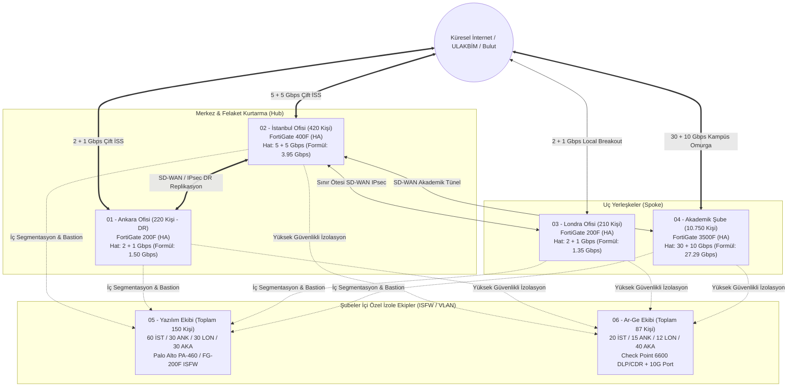

# Shcesama-tech | Kurumsal Ağ Güvenliği ve Güvenlik Duvarı (NGFW) Planlama Projesi

> Contributed by **Batuhan Seydi** ([@Shcesama](https://github.com/Shcesama)) · BGT207 Güvenlik Duvarı Çözümleri · 2026-2027 Güz Projesi.

Bu proje, **Shcesama-tech** bünyesindeki 4 ana fiziksel yerleşkenin (**İstanbul Genel Merkez, Ankara Kamu & DR Ofisi, Londra Uluslararası Ofisi, Akademik Şube**) ve şubeler genelinde faaliyet gösteren 2 kritik uzmanlık biriminin (**150 Kişilik Yazılım Ekibi ve 87 Kişilik Ar-Ge Ekibi**) ağ güvenliği mimarisini, kişi/rol bazlı bant genişliği kapasite hesaplamalarını, Yeni Nesil Güvenlik Duvarı (NGFW) donanım seçimlerini, güvenlik kural matrislerini, izleme (NOC/SOC) süreçlerini ve kriz senaryolarını uçtan uca dokümante etmektedir.

---

## 1. Şube Bazlı Kişi Sayısı, Bant Genişliği ve Güvenlik Duvarı Matrisi

Kurumumuz tüm yerleşkelerinde toplam **775 İdari Personel**, **400 Akademisyen (Faculty)**, **10.000 Öğrenci**, **150 Yazılım Mühendisi**, **133 Teknik Personel**, **55 Güvenlik Uzmanı (SOC)** ve **87 Ar-Ge Araştırmacısı** olmak üzere toplam **11.600 kullanıcıya** hizmet vermektedir.

| Şube (Branch) | İdari (Admin) | Akademisyen (Faculty) | Öğrenci (Students) | Yazılım (Software) | Teknik (Technical) | Güvenlik (Security) | Ar-Ge (R&D) | Toplam Kişi | Gereken Hız (Formül) | Birincil + Yedek Hat | Seçilen NGFW (HA Çifti) |
| :--- | :---: | :---: | :---: | :---: | :---: | :---: | :---: | :---: | :---: | :---: | :--- |
| **02 - İstanbul Ofisi (HQ)** | 280 | 0 | 0 | 60 | 35 | 25 | 20 | **420** | 3.95 Gbps | **5 + 5 Gbps** | **FortiGate 400F (HA)** |
| **01 - Ankara Ofisi (DR)** | 140 | 0 | 0 | 30 | 20 | 15 | 15 | **220** | 1.50 Gbps | **2 + 1 Gbps** | **FortiGate 200F (HA)** |
| **03 - Londra Ofisi (UK)** | 135 | 0 | 0 | 30 | 18 | 15 | 12 | **210** | 1.35 Gbps | **2 + 1 Gbps** | **FortiGate 200F (HA)** |
| **04 - Akademik Şube** | 220 | 400 | **10.000** | 30 | 60 | 0 | 40 | **10.750** | 27.29 Gbps | **30 + 10 Gbps** | **FortiGate 3500F (HA)** |
| **TOPLAM** | **775** | **400** | **10.000** | **150** | **133** | **55** | **87** | **11.600** | **34.09 Gbps** | **39 + 17 Gbps** | **+ ISFW: PA-460 & CP 6600** |

### Özel Uzmanlık Birimleri (Çapraz Fonksiyonel Ekipler)
Tabloda yer alan **150 kişilik Yazılım Ekibi** ve **87 kişilik Ar-Ge Ekibi**, bulundukları şubelerin içerisinde özel izole VLAN'larda, fiziksel ayrı 10G portlarda ve ek iç güvenlik duvarı (Internal Segmentation Firewall - ISFW) katmanları arkasında korunmaktadır:
- **05 - Yazılım Ekibi (Toplam 150 Kişi: 60 İST, 30 ANK, 30 LON, 30 AKA — 2.12 Gbps Toplam Pay):** CI/CD boru hatları, kaynak kod depoları, Bastion Host erişimi ve bulut geliştirme ortamları için özel segmentasyon (**Palo Alto PA-460 / FortiGate 200F ISFW**).
- **06 - Ar-Ge Ekibi (Toplam 87 Kişi: 20 İST, 15 ANK, 12 LON, 40 AKA — 1.86 Gbps Toplam Pay):** Patent çalışmaları, prototip laboratuvarları ve ticari sırlar için sıfır sızıntı (DLP, Threat Extraction CDR ve Air-Gap benzeri Staging sunucu) izolasyon planlaması (**Check Point Quantum 6600 ISFW + Fiziksel 10G Portlar**).

---

## 2. Kurumsal Ağ Topolojisi ve Şubeler Arası Bağlantı

Tüm yerleşkelerimiz **Hub-and-Spoke (Merkez ve Uçlar) SD-WAN** mimarisi ile birbirine bağlıdır. İstanbul Ofisi (`02-istanbul-ofisi`) 5 + 5 Gbps çift simetrik hattı ve **FortiGate 400F HA** kümesiyle ana veri merkezi (Primary Hub) rolündedir; Ankara Ofisi (`01-ankara-ofisi`) ise Felaket Kurtarma (Disaster Recovery - DR Hub) merkezidir.

---

## 3. Şube ve Ekip Bazlı Detaylı Ağ, Bant Genişliği, NGFW Seçimi ve Kurallar

### 3.1. 02 - İstanbul Ofisi (Genel Merkez, Ana Veri Merkezi ve Merkez SOC — 420 Kişi)

- **Cihaz Envanteri (Toplam 1.555 Aktif Cihaz):** 280 İdari (840 cihaz), 60 Yazılım (185 cihaz; 25 GitLab/CI-CD/K8s sunucu), 35 Teknik (205 cihaz; 90 Ana Veri Merkezi sunucusu), 25 Güvenlik / Merkez SOC (110 cihaz; 20 SIEM/SOAR/FortiManager/Analyzer sunucusu), 20 Ar-Ge (60 cihaz; 20 Merkez Veri Kasası & AI sunucusu) ve ortak altyapı/misafir (~60 misafir, 95 switch/AP/CCTV = 155 cihaz).
- **Formül Bazlı Bant Genişliği (`3.95 Gbps`) ve Hat (`5 + 5 Gbps`):**
  - 280 İdari (~4.5 Mbps) = **1.260 Mbps** (Öncelik 2-3)
  - 60 Yazılım (~15.0 Mbps) = **900 Mbps** (Öncelik 2)
  - 35 Teknik + Ana Veri Merkezi & Hub/DR Akışı = **850 Mbps** (Öncelik 1)
  - 20 Ar-Ge (~22.5 Mbps) = **450 Mbps** (Öncelik 1-2)
  - 25 Güvenlik / Merkez SOC (11.600 kişilik kurumun log akışı, ~14.0 Mbps) = **350 Mbps** (Öncelik 1)
  - Misafir Wi-Fi ve Güncellemeler = **140 Mbps** (Öncelik 4)
  - **Toplam:** **3.95 Gbps (3.950 Mbps)** $\rightarrow$ Türk Telekom Metro Ethernet **5 Gbps** (`x1` 10G SFP+) + Turkcell Superonline Bağımsız Fiber **5 Gbps** (`x2` 10G SFP+) Aktif-Aktif SD-WAN.

#### İstanbul VLAN ve Alt Ağ Planı (`10.20.0.0/16`)
| VLAN ID | VLAN Adı | Güvenlik Bölgesi (Zone) | Alt Ağ (Subnet) | Kullanıcı / Cihaz Grubu | İzolasyon Özeti |
| :---: | :--- | :--- | :--- | :--- | :--- |
| **VLAN 10** | `IST-MGMT-SOC` | Management & SOC | `10.20.10.0/24` | 35 Teknik + 25 Güvenlik (SOC) | Merkezi SIEM, FortiManager ve Altyapı Yönetimi (`10.20.10.2-3`) |
| **VLAN 20** | `IST-ADMIN` | Trust-Admin | `10.20.20.0/23` | 280 İdari Personel | Finans, İK, Satış ve Yönetim (FSSO kimlik bazlı) |
| **VLAN 30** | `IST-SOFTWARE` | Trust-Dev | `10.20.30.0/24` | 60 Yazılım Mühendisi | Bastion Host (`10.20.30.10`) ve CI/CD (`10.20.35.0/24`) erişimi |
| **VLAN 40** | `IST-RD-VAULT` | Restricted-RD | `10.20.40.0/24` | 20 Ar-Ge Araştırmacısı | `x7` fiziksel ayrı 10G SFP+ port, Staging (`10.20.40.250`) ve Patent Kasası (`10.20.45.0/24`) |
| **VLAN 50** | `IST-DC-SRV` | Datacenter-Core | `10.20.50.0/24` | Ana Veri Merkezi Sunucuları | AD, ERP, Veritabanı, SIEM (`x5+x6` 20G LACP Trunk) |
| **VLAN 60** | `IST-DMZ` | DMZ | `10.20.60.0/24` | Dış Web ve E-Posta Geçidi | İç ağa bağlantı başlatması kesinlikle engelli |
| **VLAN 90** | `IST-GUEST` | Untrust-Guest | `172.16.20.0/23` | Misafir Wi-Fi | İç ağa tamamen kapalı, 100 Mbps hız sınırlı |

#### İstanbul Top-5 NGFW Karşılaştırması ve Seçim Kararı (`FortiGate 400F HA`)
| Model | Ham FW | IPS / NGFW | Threat Protection | SSL Inspection | IPsec VPN | Oturum | Karar ve Gerekçe |
| :--- | :---: | :---: | :---: | :---: | :---: | :---: | :--- |
| **1. FortiGate 400F (SEÇİLEN)** | 79 Gbps | 12 / 10 Gbps | **9.0 Gbps** | **8.0 Gbps** | **55 Gbps** | 7.8 Milyon | **Kazanan:** NP7 + CP9 ASIC, 8x 10G SFP+ port, 3.95 Gbps yüke ve 5+5 Gbps hatta %100+ pay. |
| **2. FortiGate 200F** | 27 Gbps | 5.0 / 3.5 Gbps | 3.0 Gbps | 4.0 Gbps | 13 Gbps | 3.0 Milyon | **Elendi:** 3.0 Gbps Threat hızı İstanbul'un 3.95 Gbps yükü ve 5 Gbps hatları için yetersiz. |
| **3. Palo Alto PA-1420** | 12.5 Gbps | — | 6.2 Gbps | ~3.8 Gbps | 4.8 Gbps | 1.4 Milyon | **Elendi:** SSL hızı (~3.8 Gbps) sınırda, IPsec VPN kapasitesi (4.8 Gbps) merkez Hub için düşük. |
| **4. Check Point Quantum 6700** | 40 Gbps | 12.5 Gbps | 6.5 Gbps | ~4.5 Gbps | 8.2 Gbps | 4.0 Milyon | **Elendi:** 10G SFP+ portlar ek modül gerektirir, yüksek lisans maliyeti. |
| **5. Cisco Secure FW 3120** | 22 Gbps | 22 / 11 Gbps | 11.0 Gbps | 3.2 Gbps | 5.5 Gbps | 2.0 Milyon | **Elendi:** 3.2 Gbps SSL Inspection hızı 3.95 Gbps formül ihtiyacının altında kalır. |

---

### 3.2. 01 - Ankara Ofisi (Kamu İlişkileri ve Felaket Kurtarma / DR Merkezi — 220 Kişi)

- **Cihaz Envanteri (Toplam 790 Aktif Cihaz):** 140 İdari (420 cihaz), 30 Yazılım (90 cihaz; 10 yerel test/runner), 20 Teknik (95 cihaz; 35 DR sunucu & depolama), 15 Güvenlik / DR SOC (65 cihaz; 10 log/analiz sunucusu), 15 Ar-Ge (45 cihaz; 15 prototip & kasa) ve ortak altyapı/misafir (~30 misafir, 45 switch/AP/CCTV = 75 cihaz).
- **Formül Bazlı Bant Genişliği (`1.50 Gbps`) ve Hat (`2 + 1 Gbps`):**
  - 140 İdari (~3.5 Mbps) = **490 Mbps** | 30 Yazılım (~12.0 Mbps) = **360 Mbps** | 15 Ar-Ge (~15.0 Mbps) = **225 Mbps** | 20 Teknik + İstanbul DR Veri Replikasyonu = **220 Mbps** | 15 Güvenlik / SOC (~8.0 Mbps) = **120 Mbps** | Misafir & Güncellemeler = **85 Mbps** $\rightarrow$ **Toplam: 1.50 Gbps (1.500 Mbps)**.
  - **İnternet Hatları:** Birincil Türk Telekom Metro Ethernet **2 Gbps Simetrik** (`x1` 10G SFP+ port üzerinden, 1G port darboğazı olmadan) + Yedek Superonline Fiber **1 Gbps Simetrik** (`port1`).

#### Ankara VLAN ve Alt Ağ Planı (`10.10.0.0/16`)
| VLAN ID | VLAN Adı | Güvenlik Bölgesi (Zone) | Alt Ağ (Subnet) | Kullanıcı / Cihaz Grubu | İzolasyon Özeti |
| :---: | :--- | :--- | :--- | :--- | :--- |
| **VLAN 10** | `ANK-MGMT` | Management | `10.10.10.0/24` | 20 Teknik + 15 Güvenlik Uzmanı | Ağ cihazları ve Firewall yönetimi (`10.10.10.2-3`) |
| **VLAN 20** | `ANK-ADMIN` | Trust-Admin | `10.10.20.0/23` | 140 İdari Personel + IP Telefonlar | Standart kurumsal erişim |
| **VLAN 30** | `ANK-SOFTWARE` | Trust-Dev | `10.10.30.0/24` | 30 Yazılım Mühendisi | Bastion (`10.10.30.10`) ve DR Git/CI-CD (`10.10.35.0/24`) |
| **VLAN 40** | `ANK-RD-ISO` | Restricted-RD | `10.10.40.0/24` | 15 Ar-Ge Araştırmacısı | `x4` fiziksel ayrı 10G SFP+ port, Beyaz Liste & DLP korumalı |
| **VLAN 50** | `ANK-DR-SRV` | Datacenter-DR | `10.10.50.0/24` | Felaket Kurtarma (DR) Sunucuları | Sadece İstanbul Merkez replikasyonuna açık |
| **VLAN 90** | `ANK-GUEST` | Untrust-Guest | `172.16.10.0/24` | Misafir Wi-Fi | İç ağa tamamen kapalı, `WAN2` üzerinden 50 Mbps hız sınırlı |

#### Ankara Top-5 NGFW Karşılaştırması ve Seçim Kararı (`FortiGate 200F HA`)
- **Seçilen Model:** **FortiGate 200F (HA)** — 27 Gbps FW, 5.0 Gbps IPS, 3.5 Gbps NGFW, **3.0 Gbps Threat Protection**, **4.0 Gbps SSL Inspection**, **13.0 Gbps IPsec VPN**, 3 Milyon oturum ve **4x 10G SFP+ port** ile 1.50 Gbps ihtiyacı ve 2+1 Gbps hattı %100 güvenlik payıyla karşılar.
- **Elenen Adaylar:** **FortiGate 100F** (1.0 Gbps Threat/SSL hızı 1.50 Gbps yükte 500 Mbps darboğaz yaratır), **Palo Alto PA-1410** (Fortinet Security Fabric bütünlüğü ve TCO nedeniyle elendi), **Check Point Quantum 6600** (10G SFP+ ek modül ve lisans maliyeti), **Cisco Secure FW 3110** (2.6 Gbps SSL hızı düşük ve ayrı FMC maliyeti).

---

### 3.3. 03 - Londra Ofisi (Uluslararası Operasyonlar ve UK-GDPR — 210 Kişi)

- **Cihaz Envanteri (Toplam 731 Aktif Cihaz):** 135 İdari (405 cihaz), 30 Yazılım (90 cihaz; 10 yerel CI/CD), 18 Teknik (71 cihaz; 15 yerel RODC/dosya/bulut geçidi), 15 Güvenlik / UK-SOC (63 cihaz; 8 UK-GDPR denetim/log sunucusu), 12 Ar-Ge (37 cihaz; 12 uluslararası patent/lab) ve ortak altyapı/misafir (~25 misafir, 40 switch/AP/CCTV = 65 cihaz).
- **Formül Bazlı Bant Genişliği (`1.35 Gbps`) ve Hat (`2 + 1 Gbps`):**
  - 135 İdari (~3.3 Mbps) = **445 Mbps** | 30 Yazılım (~12.0 Mbps) = **360 Mbps** | 12 Ar-Ge (~15.0 Mbps) = **180 Mbps** | 18 Teknik + İstanbul SD-WAN Tüneli = **180 Mbps** | 15 Güvenlik / UK-SOC (~8.0 Mbps) = **120 Mbps** | Misafir & Güncellemeler = **65 Mbps** $\rightarrow$ **Toplam: 1.35 Gbps (1.350 Mbps)**.
  - **İnternet Hatları ve SaaS Local Breakout:** Birincil BT Openreach Dedicated Leased Line **2 Gbps Simetrik** (`x1` 10G SFP+) + Yedek Virgin Media Business / Colt Fiber **1 Gbps Simetrik** (`port1`). M365, Teams ve Salesforce trafiği Türkiye'ye dolaştırılmadan SSL Inspection ve UK-GDPR DLP denetiminden geçerek doğrudan Londra'dan (`< 5 ms` gecikmeyle) çıkarılır.

#### Londra VLAN ve Alt Ağ Planı (`10.30.0.0/16`)
| VLAN ID | VLAN Adı | Güvenlik Bölgesi (Zone) | Alt Ağ (Subnet) | Kullanıcı / Cihaz Grubu | İzolasyon Özeti |
| :---: | :--- | :--- | :--- | :--- | :--- |
| **VLAN 10** | `LON-MGMT-SOC` | Management & Security | `10.30.10.0/24` | 18 Teknik + 15 Güvenlik Uzmanı | UK-SOC, Switch, AP ve Firewall yönetimi (`10.30.10.2-3`) |
| **VLAN 20** | `LON-ADMIN` | Trust-Admin | `10.30.20.0/23` | 135 İdari Personel + IP Telefonlar | Küresel satış, finans ve SaaS Local Breakout ağı |
| **VLAN 30** | `LON-SOFTWARE` | Trust-Dev | `10.30.30.0/24` | 30 Yazılım Mühendisi | Bastion (`10.30.30.10`), CI/CD (`10.30.35.0/24`) ve AWS/Azure UK erişimi |
| **VLAN 40** | `LON-RD-ISO` | Restricted-RD | `10.30.40.0/24` | 12 Ar-Ge Araştırmacısı | `x4` fiziksel ayrı 10G SFP+ port, Beyaz Liste & DLP korumalı |
| **VLAN 50** | `LON-LOCAL-SRV` | Local-Server | `10.30.50.0/24` | Yerel RODC ve Dosya Sunucuları | İstanbul Merkez ile IKEv2 (AES-256-GCM) senkronize yerel servisler |
| **VLAN 90** | `LON-GUEST` | Untrust-Guest | `172.16.30.0/24` | Misafir Wi-Fi | UK-GDPR gereği kurumsal ağdan tamamen izole, 50 Mbps QoS sınırlı |

#### Londra Top-5 NGFW Karşılaştırması ve Seçim Kararı (`FortiGate 200F HA`)
- **Seçilen Model:** **FortiGate 200F (HA)** — Ankara şubesiyle birebir aynı donanım standardı (%100 operasyonel uyum), 3.0 Gbps Threat Protection ve 4.0 Gbps SSL Inspection ile 1.35 Gbps ihtiyacı iki katından fazla güvenlik payıyla karşılar.
- **Elenen Adaylar:** **FortiGate 100F** (1.0 Gbps Threat hızı 1.35 Gbps yükün altında), **Palo Alto PA-1410**, **Check Point Quantum 6600** ve **Sophos XGS 3100** (2.0 Gbps Threat, 2.47 Gbps SSL, opsiyonel çift PSU ve farklı üretici yönetim maliyeti nedeniyle elendi).

---

### 3.4. 04 - Akademik Şube (Üniversite-Sanayi Araştırma Kampüsü — 10.750 Kişi)

- **Cihaz Envanteri (Toplam 22.225 Aktif Cihaz):**
  - **10.000 Öğrenci:** 800 Lab PC + 8.500 Kişisel Laptop (BYOD) + 10.000 Akıllı Telefon = **19.300 Öğrenci Cihazı**.
  - **400 Akademisyen (Faculty):** 400 Kurumsal PC + 200 Laptop + 450 Mobil = **1.050 Cihaz**.
  - **220 İdari Personel:** 440 Cihaz | **60 Teknik Uzman:** 315 Cihaz (180 HPC Kümesi & Kampüs DC sunucusu dahil) | **40 Ar-Ge Araştırmacısı (Ana Ar-Ge Merkezi):** 90 Cihaz (40 Teknopark Lab & AI GPU sunucusu dahil) | **30 Yazılım Mühendisi:** 80 Cihaz (15 sunucu dahil) | **Kampüs Altyapısı:** 650 adet Wi-Fi 6E AP, Switch & IoT = **950 Cihaz**.
  - **Güvenlik Ekibi (`Security = 0`):** Akademik şubede yerel güvenlik uzmanı bulunmadığından `FortiGate 3500F` HA çifti 7/24 **İstanbul (25 uzman) ve Ankara (15 uzman) Merkez SOC** ekipleri tarafından uzaktan yönetilir.
- **Formül Bazlı Bant Genişliği (`27.29 Gbps`) ve Hat (`30 + 10 Gbps`):**
  - 10.000 Öğrenci (~2.15 Mbps eşzamanlı yük) = **21.50 Gbps (21.500 Mbps)** (Öncelik 3 - Kotalı: Kişi başı 25 Mbps, toplam 20 Gbps tavan; WAN1 koparsa 5 Gbps tavan)
  - 400 Akademisyen (~7.0 Mbps) = **2.80 Gbps (2.800 Mbps)** (Öncelik 1-2, Garantili 5 Gbps havuz)
  - 40 Ar-Ge Araştırmacısı (~25.0 Mbps AI veri seti & simülasyon) = **1.00 Gbps (1.000 Mbps)** (Öncelik 1)
  - 220 İdari Personel (~3.5 Mbps) = **0.77 Gbps (770 Mbps)** (Öncelik 2)
  - 60 Teknik Ekip & HPC Senkronu (~12.0 Mbps) = **0.72 Gbps (720 Mbps)** (Öncelik 1)
  - 30 Yazılım Mühendisi (~16.6 Mbps) = **0.50 Gbps (500 Mbps)** (Öncelik 2)
  - **Toplam:** **27.29 Gbps (27.290 Mbps)** $\rightarrow$ Birincil ULAKBİM / Metro Ethernet **30 Gbps Simetrik** (`port33` 40G/100G QSFP28) + Yedek Ticari İSS **10 Gbps Simetrik** (`port1` 10G SFP+).
- **Çoklu NAT Havuzu (`/27` PBA NAT):** 22.225 cihazın tek IP arkasında 65.535 port sınırını (Port Exhaustion) doldurmaması için 32 adet gerçek kamu IP adresinden oluşan **Port Block Allocation (PBA) NAT Havuzu** ve 5651 sayılı yasa uyumlu loglama kullanılır.

#### Akademik Şube VLAN ve Süper-Ağ Planı (`10.40.0.0/13`)
| VLAN ID | VLAN Adı | Güvenlik Bölgesi (Zone) | Alt Ağ (Subnet) | Kullanıcı / Cihaz Grubu | İzolasyon Özeti |
| :---: | :--- | :--- | :--- | :--- | :--- |
| **VLAN 10** | `AKA-MGMT` | Management | `10.40.10.0/23` | 60 Teknik Uzman + 650 AP & Switch | Kampüs ağ yönetimi (`10.40.10.2-3`; Güvenlik İstanbul SOC'de) |
| **VLAN 20** | `AKA-ADMIN` | Trust-Admin | `10.40.20.0/23` | 220 İdari Personel | Öğrenci işleri, rektörlük ve idari sistemler |
| **VLAN 30** | `AKA-FACULTY` | Trust-Faculty | `10.40.30.0/22` | 400 Akademisyen (Faculty) | Akademik araştırma ve ders yayın ağı |
| **VLAN 40** | `AKA-SOFTWARE` | Trust-Dev | `10.40.40.0/24` | 30 Yazılım Mühendisi | Bastion (`10.40.40.10`) ve kampüs DevOps (`10.40.45.0/24`) |
| **VLAN 50** | `AKA-RD-LAB` | Restricted-RD | `10.40.50.0/24` | 40 Ar-Ge Araştırmacısı | `port4` (10G SFP+) fiziksel ayrı port, Staging (`10.40.50.250`) ve GPU (`VLAN 55`) |
| **VLAN 60** | `AKA-HPC-DC` | Campus-Datacenter | `10.40.60.0/24` | Bilimsel Hesaplama (HPC) & Sunucular | `port2+port3` (50 Gbps LACP), öğrenci ağından erişime kapalı |
| **VLAN 100-110** | `AKA-STUDENTS` | Untrust-Student | `10.44.0.0/18` *(16.382 IP)* | **10.000 Öğrenci (BYOD Wi-Fi & Lab)** | İstemci İzolasyonlu (Client Isolation), 5651 Loglu, P2P/Torrent/Tor Engelli |

#### Akademik Şube Top-5 NGFW Karşılaştırması ve Seçim Kararı (`FortiGate 3500F HA`)
| Model | Ham FW | IPS / NGFW | Threat Protection | SSL Inspection | Eşzamanlı Oturum | Yeni Oturum/sn | Karar ve Gerekçe |
| :--- | :---: | :---: | :---: | :---: | :---: | :---: | :--- |
| **1. FortiGate 3500F (SEÇİLEN)** | **595 Gbps** | **65 / 63 Gbps** | **60.0 Gbps** | **52.0 Gbps** | **140 Milyon** | **1.000.000/sn** | **Kazanan:** Çoklu NP7 + CP9 ASIC, 6x 100G/40G + 32x 25G/10G port, 27.29 Gbps yüke tam yanıt. |
| **2. FortiGate 1800F** | 198 Gbps | 22 / 17 Gbps | 15.0 Gbps | 20.0 Gbps | 40 Milyon | 550.000/sn | **Elendi:** 15 Gbps Threat hızı 27.29 Gbps ihtiyaçta ~12 Gbps darboğaz yaratır. |
| **3. Palo Alto PA-5430** | 70 Gbps | — | 38.5 Gbps | ~25.0 Gbps | 15 Milyon | 430.000/sn | **Elendi:** SSL hızı (~25 Gbps) 27.29 Gbps altında kalır, oturum kapasitesi (15M) düşük ve pahalı. |
| **4. Check Point 16200** | 120 Gbps | 38 / 30 Gbps | 20.0 Gbps | ~18.0 Gbps | 20 Milyon | 380.000/sn | **Elendi:** 20 Gbps Threat ve 18 Gbps SSL hızı 30 Gbps birincil hattın altında kalır. |
| **5. Cisco Secure FW 4145** | 80 Gbps | 45 / 35 Gbps | 35.0 Gbps | 16.0 Gbps | 35 Milyon | 400.000/sn | **Elendi:** 16 Gbps SSL Inspection hızı kampüs trafiği için yetersiz. |

---

### 3.5. 05 - Yazılım Ekibi (150 Mühendis) ve 06 - Ar-Ge Ekibi (87 Araştırmacı) Özel Mimarisi

1. **05 - Yazılım Ekibi (60 İST, 30 ANK, 30 LON, 30 AKA = 150 Kişi, 325 Cihaz, 60 Sunucu, 2.12 Gbps Trafik):**
   - **Trafik Dağılımı:** CI/CD & Konteyner Senkronu (**875 Mbps**), Git & Paket Depoları (**540 Mbps**), AWS/Azure Doğrudan Bağlantı (**350 Mbps**), Scrum Video (**280 Mbps**), Araştırma (**75 Mbps**).
   - **Bastion Host ve Reverse Shell Önlemi:** Geliştiriciler (`10.x.30.0/24`) CI/CD sunucularına (`10.x.35.0/24`) doğrudan SSH yapamaz; yalnızca MFA doğrulamalı **Bastion Host (`10.x.30.10`)** üzerinden geçebilir. CI/CD sunucuları dış dünyaya rastgele bağlantı (Reverse Shell / C2) başlatamaz; sadece beyaz listedeki paket depolarına (`docker, github, npm, pypi, maven, apt`) erişebilir. App-ID ve DLP ile kişisel Git hesaplarına `git push` engellenir.
   - **İç Segmentasyon (ISFW) Seçimi:** Şube sınırındaki FortiGate'lere ek olarak derleme sunucuları önünde **Palo Alto PA-460 HA** (2.4 Gbps Threat Prevention) / **FortiGate 200F ISFW** kullanılır (Check Point 3600 1.5 Gbps hız nedeniyle, Cisco 1210CE ve Sophos XGS 3100 ekosistem uyumsuzluğu nedeniyle elenmiştir).

2. **06 - Ar-Ge Ekibi (40 AKA, 20 İST, 15 ANK, 12 LON = 87 Kişi, 170 İş İstasyonu, 87 Sunucu, 1.86 Gbps Trafik):**
   - **Trafik Dağılımı:** 4 Şube Patent Kasası & AI Model Senkronu (**850 Mbps**), Onaylı Bilimsel Veri Seti İndirme (**700 Mbps**), Beyaz Liste Araştırma (**225 Mbps**), DLP/CDR/SIEM (**80 Mbps**), Misafir Wi-Fi / Upload (**0 Mbps - Tamamen Yasak**).
   - **Fiziksel Port Ayrımı ve Kablosuz Yasağı:** Ar-Ge laboratuvarlarında Wi-Fi yoktur (yalnızca 802.1X + MACsec kablolu bağlantı). Her şubede ortak trunk yerine güvenlik duvarı üzerinde **fiziksel ayrı 10G SFP+ porta** (`FG-3500F port4`, `FG-400F x7`, `FG-200F x4`) ve ayrı VDOM'a bağlanır.
   - **Tek Yönlü Staging Sunucu (`10.x.x.250`) ve Check Point Quantum 6600 (CDR + DLP):** Patent Kasası ve Prototip ağlarının (`VLAN 45/55`) internete çıkışı %100 kapalıdır. Dışarıdan indirilen belgeler önce **Staging Sunucusuna** bırakılır; **Check Point Quantum 6600** (3.7 Gbps Threat Prevention) üzerindeki **SandBlast Threat Extraction (CDR)** ve Zero-Day Sandbox ile makrolardan temizlendikten sonra içeriye Read-Only SFTP ile çekilir. Araştırma ağından dışarıya 1 MB üzeri tüm `HTTP POST/PUT (Upload)` istekleri ve CAD/CAM parmak izleri kesilir.

---

## 4. Standart 10 Aşamalı Kurulum Metodolojisi ve QoS Politikası

Hiçbir güvenlik duvarı doğrudan canlı ağa takılmaz; tüm şubelerde şu 10 adım uygulanır:
1. **Fiziksel & Raf Montajı:** HA çiftleri arasında en az 1U boşluk, A/B bağımsız UPS fazlarına bağlı çift güç kaynağı (Redundant PSU), `ŞUBE-CİHAZ-PORT-HEDEF` kablo etiketleme ve ESD şasi topraklaması.
2. **İlk Erişim & Hardening:** Fiziksel konsol bağlantısı, varsayılan `admin` hesabının kapatılması, RADIUS/LDAP + MFA zorunluluğu, WAN arayüzlerinde yönetim erişiminin (HTTPS/SSH/Ping) kapatılması (**Trusted Hosts** — sadece `Mgmt VLAN`), HTTP/Telnet/SNMPv1-v2c iptali (sadece TLS 1.3 HTTPS, SSHv2, SNMPv3).
3. **Firmware & Lisans:** SHA-256 doğrulanmış *Önerilen Kararlı Sürüm (Mature Release)*, saatlik IPS/App-ID/AV güncellemesi ve yerel NTP + `tr.pool.ntp.org` zaman senkronizasyonu.
4. **Yüksek Erişilebilirlik (HA):** Aktif-Pasif (Hot Standby) kurgu, dedike `HA1 (Control)` ve `HA2 (Session Sync - Akademik şubede 2x 25G SFP28)` kalp atışı portları, `< 1 saniye` failover.
5. **WAN & SD-WAN:** Çift İSS bağlantısı, 100 ms aralıklarla Latency/Jitter/Packet Loss SLA sağlık kontrolleri.
6. **VLAN & Zone Tasarımı:** Management, Trust-Admin, Trust-Faculty, Trust-Dev, Restricted-RD, Datacenter/HPC, DMZ ve Untrust-Guest/Student bölgeleri.
7. **Sıfır Güven (Zero Trust):** Implicit Deny, FSSO User-ID ve App-ID bazlı kurallar, Geo-IP engelleme.
8. **SSL Inspection & Tehdit Önleme:** Kurumsal GPO kök sertifikası ile Outbound SSL/TLS DPI (sağlık/bankacılık siteleri hariç), IPS, Zero-Day Sandbox ve DNS Sinkhole.
9. **QoS ve Traffic Shaping (4 Kademeli Önceliklendirme):**
   - **1. Öncelik (Kritik):** VoIP, Video Konferans, SD-WAN SLA, DR ve SIEM/SOC trafiği.
   - **2. Öncelik (İş Kritik):** Kurumsal ERP, CRM, Git, CI/CD, Bulut ve Akademik araştırma veri tabanları.
   - **3. Öncelik (Standart İş):** Web gezintisi, kurumsal e-posta, standart öğrenci eğitim trafiği (kişi başı 25 Mbps sınır).
   - **4. Öncelik (Kısıtlı):** Güncellemeler, yedeklemeler ve Misafir Ağı (hattın en fazla %10'u; İstanbul 100 Mbps, Ankara/Londra 50 Mbps tavan).
10. **Merkezi Loglama & Kabul Testleri (UAT):** FortiManager ve SIEM bağlantısı, gece 03:00 otomatik Vault yedeği, HA Failover, WAN kopma, VLAN izolasyon ve EICAR/DLP kabul testleri.

---

## 5. İzleme Mimarisi: Sistematik Kısım ve İnsan Kısmı (NOC & SOC)

### 5.1. Sistematik Kısım (7/24 Otomatik İzleme ve Müdahale)
Merkezi Ağ İzleme Sistemi (**Zabbix / PRTG**) her güvenlik duvarını 30 saniyede bir SNMPv3 ve Streaming Telemetry ile sorgular; **Merkezi SIEM & SOAR (FortiAnalyzer + Wazuh)** ise logları korele eder:

| İzlenen Metrik / Olay | Uyarı Eşiği (Warning) | Kritik Eşiği (Critical) | Otomatik Sistem Aksiyonu (SOAR / NMS) |
| :--- | :---: | :---: | :--- |
| **CPU Kullanımı** | %70 (5 dk) | %85 (2 dk) | Ağ ekibine bildirim + en çok oturum açan IP'lerin raporlanması |
| **Bellek (RAM) Kullanımı** | %75 | %85 | Conserve Mode öncesi acil uyarı |
| **WAN Bant Genişliği** | %80 (15 dk ort.) | %92 (5 dk ort.) | QoS sıkılaştırma + Düşük öncelikli trafiğin ikincil hatta kaydırılması |
| **Eşzamanlı Oturum (Session)** | Kapasitenin %60'ı | Kapasitenin %80'i | SYN Flood / DDoS koruma profillerinin agresif moda alınması |
| **SD-WAN Gecikme / Kayıp** | >80ms / >%1 | >150ms / >%3 | Trafiğin kesintisiz olarak yedek İSS hattına aktarılması |
| **Donanım Sağlığı (PSU/Isı)** | Isı > 65°C | Tek PSU / HA Kopması | Sistem yöneticilerine anında SMS ve otomatik telefon araması |
| **Brute-Force Girişimi** | — | 1 dk içinde >10 hata | Kaynak IP tüm şube güvenlik duvarlarında 24 saat otomatik Blocklist'e alınır |
| **C2 DNS Sorgusu / Ransomware** | — | 1 adet C2 / SMB taraması | DNS Sinkhole + SOAR ile ilgili switch/Wi-Fi portunun **Karantina VLAN'ına (VLAN 99)** alınması |

### 5.2. İnsan Kısmı (55 Güvenlik / SOC ve 133 Teknik Uzman) ve SLA Hedefleri
- **Kadro:** **55 Güvenlik Uzmanı** (25 İstanbul Merkez SOC, 15 Ankara DR SOC, 15 Londra UK-SOC) ve **133 Teknik Uzman** (35 İstanbul, 20 Ankara, 18 Londra, 60 Akademik Şube). Akademik şubede yerel güvenlik personeli (`Security = 0`) olmadığı için `FortiGate 3500F` 7/24 İstanbul ve Ankara SOC tarafından uzaktan izlenir.
- **Operasyonel Takvim:**
  - **Günlük (09:00 & Vardiya Değişimi - 30 dk):** HA `In-Sync` ve İSS `Up` kontrolü, son 24 saatteki en kritik 10 IPS/Sandbox olayının incelenmesi, yanlış pozitif (False Positive) analizi.
  - **Haftalık (Cuma - 2 Saat):** Pik saat bant genişliği trend analizi, App-ID ile **Gölge BT (Shadow IT)** tespiti, VPN denetimi.
  - **Aylık (İlk Hafta - Yarım Gün):** Son 90 gündür **Hit Count = 0** olan kuralların temizlenmesi (Rulebase Hygiene) ve üretici PSIRT güvenlik yamalarının değerlendirilmesi.
  - **Çeyreklik (3 Ayda Bir - Tam Gün):** Mesai dışı canlı **HA ve WAN kablo çekme tatbikatı** ve İK listesiyle yönetici yetki denetimi.
- **Alarm Seviyeleri (SLA):** **P1 Kritik** (Telefon + SMS + SIEM, **≤ 5 dk** ilk müdahale, **≤ 30 dk** izolasyon), **P2 Yüksek** (SMS + SOC Kanalı + E-posta, **≤ 15 dk** müdahale, **≤ 2 saat** çözüm), **P3 Orta** (**≤ 1 saat** müdahale), **P4 Düşük** (**≤ 4 saat** müdahale).

---

## 6. Risk Analizi ve Gerçek Kriz Senaryoları

### Ortak Risk Değerlendirme Matrisi
| Risk No | Risk Tanımı | Etki | Olasılık (Önce) | Uygulanan NGFW Kontrolü | Kalan Risk |
| :---: | :--- | :---: | :---: | :--- | :---: |
| **R-01** | Fidye yazılımının şubeler arası yayılması | Çok Yüksek | Yüksek | VLAN Mikro-Segmentasyonu + IPS + SMB/RDP kısıtlaması | **Düşük** |
| **R-02** | Tek İSS veya tek cihaz arızasıyla şubenin durması | Yüksek | Orta | Aktif-Pasif HA Cihaz Çifti + Çift İSS SD-WAN (`39+17 Gbps`) | **Çok Düşük** |
| **R-03** | Şifreli (HTTPS) trafik içinden zararlı yazılım sızması | Yüksek | Yüksek | SSL/TLS Deep Packet Inspection + Zero-Day Sandbox | **Düşük** |
| **R-04** | 87 Kişilik Ar-Ge veya 150 Kişilik Yazımdan veri/kod sızıntısı | Çok Yüksek | Orta | DLP + Upload Engelleme + Beyaz Liste Web Filtreleme + CDR | **Çok Düşük** |
| **R-05** | Akademik şubedeki 10.000 öğrencinin ağı tüketmesi veya sızması | Yüksek | Çok Yüksek | FortiGate 3500F + Fiziksel/VLAN İzolasyonu + `/27` PBA NAT + QoS | **Çok Düşük** |

### 5 Gerçekçi Kriz Senaryosu ve Sistemin Saniye Saniye Tepkisi
1. **Senaryo 1 — Ankara Ofisinde (220 Kişi) Oltalama ve Fidye Yazılımı (Ransomware) Girişimi:** `VLAN 20` idari personeli sahte e-postadaki HTTPS bağlantısına tıklar. `FortiGate 200F` (4.0 Gbps SSL Inspection) şifreyi çözer, yeni kayıtlı domaini fark edip dosyayı **Cloud Sandbox**'a gönderir ve 45 saniyede fidye yazılımını bloklar. Zararlı USB ile girip `VLAN 40 (Ar-Ge)` ve `VLAN 50 (DR Sunucular)` ağlarına SMB (445) taraması başlatırsa, **Kural 06** geçişi reddeder ve SOAR enfekte bilgisayarı anında **Karantina VLAN'ına (VLAN 99)** taşır; diğer 219 personel ve DR sunucuları etkilenmez.
2. **Senaryo 2 — İstanbul Merkez Ofiste (420 Kişi) Birincil 5 Gbps Fiber Kablo Kopması:** Kazı çalışmasında `WAN1 (5 Gbps)` kopar. `FortiGate 400F` 100 ms aralıklarla yaptığı SD-WAN Health Check ile 300 ms içinde %100 paket kaybını algılar ve 800 ms içinde tüm trafiği `WAN2 (5 Gbps)` yedek hattına aktarır. Merkez ihtiyacı **3.95 Gbps** ve yedek hat **5.0 Gbps** olduğu için 420 çalışan sıfır hız düşüşüyle çalışmaya devam eder.
3. **Senaryo 3 — Akademik Şubede (10.750 Kişi) 15 Mpps DDoS Saldırısı ve 10.000 Öğrenci Trafik Yönetimi:** Kayıt haftasında 15 milyon paket/sn SYN/UDP Flood başlar ve yüzlerce öğrenci torrent açar. `FortiGate 3500F` üzerindeki **çoklu NP7 ASIC** çipleri sahte SYN paketlerini CPU'yu yormadan (%20 CPU) donanımda düşürür; 140 Milyon oturum tablosu dolmaz. P2P/Torrent **Kural 08** ile sıfır baytta bloklanır, öğrencilere kişi başı 25 Mbps (toplam 20 Gbps tavan) uygulanır ve kalan 10+ Gbps kapasite 400 Akademisyen ile 40 Ar-Ge araştırmacısına kesintisiz ayrılır. Alarm anında İstanbul Merkez SOC ekranına düşer.
4. **Senaryo 4 — Ar-Ge Ekibinde (87 Kişi) İçeriden Veri Sızıntısı (Data Exfiltration) Girişimi:** Araştırmacı `.step` (CAD) ve `.zip` (AI model ağırlıkları) dosyalarını sızdırmak ister. Google Drive/WeTransfer **Beyaz Liste (Whitelist)** tarafından engellenir. İzinli bir patent sitesine 50 MB dosya yüklemeyi (HTTP POST) denediğinde **DLP (1 MB Upload sınırı ve belge parmak izi)** bağlantıyı anında keser ve 55 kişilik SOC ekibine **P1 Kritik Veri Sızıntısı** alarmı üretir.
5. **Senaryo 5 — Yazılım Ekibinde (150 Kişi) Canlı Sürüm Sırasında Güvenlik Duvarı Donanım Arızası (HA Failover):** CI/CD dağıtımı sırasında birincil güvenlik duvarı kapanır. İkincil (Passive) cihaz `HA1/HA2` portlarından 300 ms içinde Heartbeat kaybını algılar, 700 ms içinde Gratuitous ARP ile sanal MAC adresini devralır. Oturumlar `HA2` üzerinden senkronize olduğu için açık Docker yüklemeleri, Git push işlemleri ve Bastion SSH bağlantıları kopmadan devam eder.
